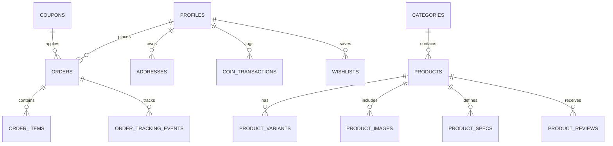
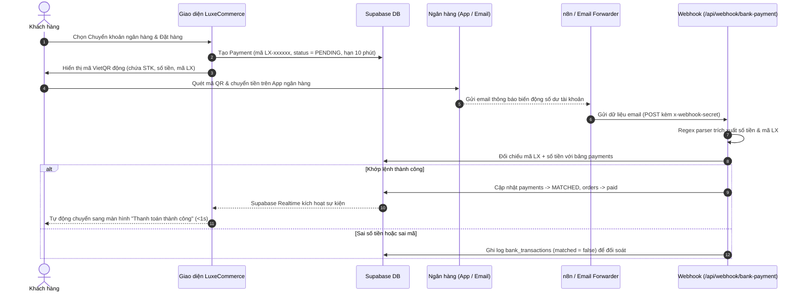

# LuxeCommerce — Nền tảng Thương mại Điện tử Đẳng cấp & Quản trị Toàn diện

<div align="center">
  
  <h3>LuxeCommerce — Trải nghiệm mua sắm hàng hiệu đẳng cấp</h3>
  <p>Hệ sinh thái E-Commerce toàn diện kết hợp giữa Storefront Soft Premium, hệ thống thành viên VIP & Xu thưởng, cùng Bảng điều khiển Quản trị (Admin Dashboard) thời gian thực.</p>

  <p>
    
    
    
    
    
    
    
  </p>
</div>

---

## 📖 Mục lục

- [Giới thiệu dự án](#-giới-thiệu-dự-án)
- [Tính năng nổi bật](#-tính-năng-nổi-bật)
  - [1. Storefront (Trải nghiệm Mua sắm Khách hàng)](#1-storefront-trải-nghiệm-mua-sắm-khách-hàng)
  - [2. Hệ thống Khách hàng Thân thiết & VIP](#2-hệ-thống-khách-hàng-thân-thiết--vip)
  - [3. Bảng điều khiển Quản trị (Admin Dashboard)](#3-bảng-điều-khiển-quản-trị-admin-dashboard)
  - [4. Tích hợp AI, Bản đồ & Thanh toán Tự động](#4-tích-hợp-ai-bản-đồ--thanh-toán-tự-động)
- [Công nghệ sử dụng](#-công-nghệ-sử-dụng)
- [Kiến trúc Thư mục](#-kiến-trúc-thư-mục)
- [Mô hình Dữ liệu & Cơ sở dữ liệu](#-mô-hình-dữ-liệu--cơ-sở-dữ-liệu)
- [Biến môi trường (Environment Variables)](#-biến-môi-trường-environment-variables)
- [Hướng dẫn Cài đặt & Chạy Local](#-hướng-dẫn-cài-đặt--chạy-local)
- [Các luồng nghiệp vụ cốt lõi](#-các-luồng-nghiệp-vụ-cốt-lõi)
- [Phân quyền Người dùng (RBAC Matrix)](#-phân-quyền-người-dùng-rbac-matrix)
- [Tác giả & Bản quyền](#-tác-giả--bản-quyền)

---

## 🌟 Giới thiệu dự án

**LuxeCommerce** ban đầu được khởi tạo từ bộ khung mã nguồn mở `shadcn-admin-dashboard-free`, sau đó được mở rộng và tái cấu trúc toàn diện thành một **nền tảng thương mại điện tử chuyên nghiệp, hoàn chỉnh cả 2 mặt Storefront (Cửa hàng) và Dashboard (Quản trị)**.

Dự án được xây dựng dựa trên triết lý thiết kế **Soft Premium**: giao diện tối giản, hiện đại, bo góc mềm mại (`rounded-2xl` đến `rounded-3xl`), tương phản thị giác nhẹ nhàng, hỗ trợ đầy đủ cả **Chế độ Sáng (Light Mode)** và **Chế độ Tối (Dark Mode)**, đồng thời chuẩn hóa responsive 100% trên cả **Mobile, Tablet và Desktop**.

---

## 🚀 Tính năng nổi bật

### 1. Storefront (Trải nghiệm Mua sắm Khách hàng)
- **Trang chủ tương tác:** Banner quảng cáo động đa tầng (Carousel với `embla-carousel-react`), phân chia danh mục hàng hiệu, sản phẩm nổi bật, ưu đãi giới hạn.
- **Tìm kiếm & Bộ lọc nâng cao:** Tìm kiếm tức thì với cơ chế debounce, lọc sản phẩm theo danh mục đa cấp, khoảng giá, thương hiệu, sắp xếp theo giá và độ phổ biến.
- **Trang Chi tiết Sản phẩm (Product Details):**
  - Thư viện ảnh sản phẩm độ phân giải cao, hỗ trợ phóng to và xem nhiều góc độ.
  - Tùy chọn biến thể động (màu sắc, kích cỡ, dung lượng...) với SKU và giá cộng thêm linh hoạt.
  - Bảng thông số kỹ thuật (Specifications) chi tiết.
  - Hệ thống đánh giá & bình luận sao (1-5 sao) liên kết với tài khoản mua hàng thực tế.
  - Gợi ý sản phẩm liên quan theo danh mục.
- **Giỏ hàng Real-time:** Cập nhật số lượng tức thì, tự động kiểm tra lượng hàng tồn kho của từng biến thể trước khi tiến hành thanh toán.
- **Quy trình Thanh toán (Checkout) Thông minh:**
  - Sổ địa chỉ giao hàng thông minh, phân loại "Nhà riêng" / "Văn phòng".
  - Bản đồ tương tác **Leaflet & OpenStreetMap (OSM)**: Cho phép chọn và ghim vị trí giao hàng trực quan trên bản đồ, lưu tọa độ GPS (Vĩ độ / Kinh độ) hoàn toàn miễn phí, không yêu cầu API key.
  - Tự động tính toán khoảng cách vận chuyển theo công thức **Haversine** (giữa Kho tổng và tọa độ GPS khách hàng) để ước lượng phí giao hàng chính xác theo từng cự ly.
  - Áp dụng mã giảm giá (Coupon code) với điều kiện đơn hàng tối thiểu (`min_order_amount`) và giới hạn số lần sử dụng.
  - Đa dạng phương thức thanh toán: **COD (Thanh toán khi nhận hàng)** và **Chuyển khoản Ngân hàng tự động qua VietQR**.
- **Theo dõi Đơn hàng Công khai (Order Tracking):**
  - Khách hàng có thể tra cứu đơn hàng bằng Mã vận đơn / Mã đơn hàng mà không bắt buộc phải đăng nhập.
  - Thanh tiến trình mốc giao hàng trực quan (Đã đặt $\rightarrow$ Đang xử lý $\rightarrow$ Đang giao $\rightarrow$ Đã nhận) kèm lịch sử sự kiện chi tiết theo thời gian thực.

---

### 2. Hệ thống Khách hàng Thân thiết & VIP
- **Thẻ Thành viên VIP (Digital Membership Card):**
  - 4 Hạng thành viên chính thức: **Đồng (Bronze)** $\rightarrow$ **Bạc (Silver)** $\rightarrow$ **Vàng (Gold)** $\rightarrow$ **Kim Cương (Diamond)** cùng nhận diện huy hiệu đặc biệt dành cho **Admin** và **Staff** với bộ icon Flaticon độc quyền.
  - Hiển thị thanh tiến trình nâng hạng dựa trên tổng chi tiêu tích lũy, đi kèm đặc quyền cho từng hạng.
- **Hệ sinh thái Xu thưởng (LuxeCoins):**
  - Cơ chế hoàn Xu tự động sau khi đơn hàng chuyển sang trạng thái "Đã giao hàng thành công" (xử lý an toàn qua PostgreSQL Trigger).
  - Nhật ký biến động số dư Xu minh bạch (Cộng xu từ đơn hàng, Trừ xu khi đổi quà, Nhận xu từ giới thiệu).
- **Hệ thống Giới thiệu Bạn bè (Referral System):**
  - Mỗi khách hàng sở hữu một Mã giới thiệu (Referral Code) độc nhất.
  - Tặng Xu thưởng cho cả người giới thiệu và người được giới thiệu khi bạn bè hoàn tất đơn hàng đầu tiên.
- **Trung tâm Đổi thưởng (Rewards Center):**
  - Khách hàng dùng Xu tích lũy để đổi lấy các Voucher giảm giá độc quyền.
- **Danh sách Yêu thích (Wishlist):**
  - Lưu sản phẩm yêu thích, phân chia theo nhóm danh mục riêng kèm ghi chú cá nhân.

---

### 3. Bảng điều khiển Quản trị (Admin Dashboard)
- **Tổng quan Kinh doanh (Analytics):**
  - Biểu đồ thống kê doanh thu theo thời gian (`recharts`).
  - Phân bổ trạng thái đơn hàng, sản phẩm bán chạy, tỷ lệ chuyển đổi khách hàng mới.
- **Quản lý Sản phẩm Chuyên sâu (Product Management):**
  - Trình soạn thảo văn bản phong phú (Tiptap / MDX Editor) hỗ trợ nhập mô tả chi tiết bằng HTML.
  - Tải lên bộ sưu tập ảnh sản phẩm lưu trữ an toàn trên Supabase Storage.
  - **Đồng bộ Tồn kho 2 Chiều (Biến thể $\leftrightarrow$ Kho chung):**
    - Tự động cộng dồn tồn kho của các biến thể vào tổng tồn kho chung theo thời gian thực.
    - Cảnh báo trực quan khi có sự chênh lệch tồn kho.
    - Nút thao tác nhanh 1-click: *Cập nhật kho theo biến thể* hoặc *Chia đều kho vào các biến thể*.
    - Bảo toàn toàn vẹn dữ liệu: đảm bảo số lượng tồn kho sản phẩm trong database luôn chuẩn xác.
- **Quản lý Danh mục (Category Management):**
  - Phân cấp danh mục đa tầng, hỗ trợ tạo nhanh danh mục trực tiếp ngay trong biểu mẫu sản phẩm.
- **Vận hành Đơn hàng Thời gian thực (Order Operations):**
  - Lắng nghe sự kiện đơn hàng mới qua Supabase Realtime không cần tải lại trang.
  - Cập nhật trạng thái đơn hàng theo quy trình chuẩn và tự động ghi nhận sự kiện hành trình giao vận (Tracking milestones).
  - Khách hàng được phép hủy đơn khi đơn hàng còn ở trạng thái "Chờ xử lý".
- **Quản lý Khuyến mãi & Voucher (Coupons):**
  - Tạo mã giảm giá theo tỷ lệ phần trăm (%) hoặc số tiền cố định (VNĐ).
  - Thiết lập giá trị đơn hàng tối thiểu, mức giảm tối đa, giới hạn lượt dùng và thời hạn hiệu lực.
- **Quản lý Banner Quảng cáo (Promo Banners):**
  - Quản lý hình ảnh banner hiển thị trên trang chủ, đường dẫn liên kết và thứ tự hiển thị ưu tiên.
- **Phân quyền & Tài khoản (Users & RBAC):**
  - Phân bổ vai trò (Roles): Admin, Staff, Customer.
  - Khóa / Mở khóa tài khoản người dùng (`is_locked`).
  - Đồng bộ thông tin avatar và họ tên tức thì từ Google OAuth.
- **Hệ thống Thông báo (Notification Hub):**
  - Gửi thông báo hệ thống trực tiếp cho từng người dùng hoặc phát sóng toàn hệ thống (Broadcast).

---

### 4. Tích hợp AI, Bản đồ & Thanh toán Tự động
- **Trợ lý AI Bán hàng (Gemini Chatbot):**
  - Widget chat nổi trực tuyến tích hợp Google GenAI SDK (`@google/genai`).
  - Tự động tư vấn sản phẩm, giải đáp thắc mắc về chính sách giao hàng, thanh toán và bảo hành.
- **Bản đồ Tương tác Leaflet & OpenStreetMap (OSM):**
  - Tích hợp thư viện Leaflet cùng Tile Layer từ OpenStreetMap (OSM) mã nguồn mở, hoạt động ổn định và hoàn toàn miễn phí mà không cần đăng ký API key.
  - Hỗ trợ ghim điểm giao hàng trực quan, tự động trích xuất tọa độ GPS (Vĩ độ / Kinh độ).
  - Thuật toán khoảng cách **Haversine** nội bộ tính toán cự ly thực tế từ Kho tổng (TP. Hồ Chí Minh) đến vị trí khách hàng để phân tầng phí ship chính xác (Hỏa tốc, Trong ngày, Ngoại thành, Liên tỉnh).
  - *(Tùy chọn mở rộng)*: Hỗ trợ tự động chuyển sang Goong Maps nếu được cấu hình thêm key trong tương lai.
- **Thanh toán Tự động VietQR & Khớp lệnh qua Email Ngân hàng:**
  - Tự động sinh mã thanh toán độc nhất dạng `LX-xxxxxx` (tránh các ký tự gây nhầm lẫn) và render mã **VietQR động** chuẩn NAPAS (chứa chính xác số tài khoản, tên chủ thẻ, số tiền và nội dung chuyển khoản).
  - Tích hợp Webhook thông minh (`/api/webhook/bank-payment`) kết nối với luồng n8n / email forwarder để bắt email thông báo biến động số dư từ ngân hàng.
  - Bộ bóc tách Regex tự động nhận diện nội dung email ngân hàng (Vietcombank, MBBank, Techcombank, Cake...): trích xuất chính xác số tiền, thời gian giao dịch, mã giao dịch và mã `LX-xxxxxx`.
  - Cơ chế đối chiếu 2 lớp (Mã thanh toán + Số tiền): Khi khớp hoàn toàn, hệ thống tự động đổi trạng thái thanh toán sang `MATCHED` và đơn hàng sang `paid`, đồng thời kích hoạt **Supabase Realtime** chuyển màn hình thanh toán thành công tức thì trên trình duyệt khách hàng mà không cần F5.
  - Tự động chống trùng lặp giao dịch (Deduplication) qua mã định danh `gmail_message_id` / `transaction_id`.
- **Email Thông báo Giao dịch:**
  - Tự động gửi email xác nhận đặt hàng và cập nhật đơn hàng cho khách qua **Nodemailer (Gmail SMTP)**.
  - Ghi nhận lịch sử gửi thư vào bảng `email_send_logs` để dễ dàng tra cứu.

---

## 🛠 Công nghệ sử dụng

| Lĩnh vực | Công nghệ | Mục đích sử dụng |
|---|---|---|
| **Core Framework** | [Next.js 16 (App Router)](https://nextjs.org/) | Framework Full-stack, Server Components, tối ưu hóa tốc độ với Turbopack |
| **Frontend Library** | [React 19](https://react.dev/) + [TypeScript](https://www.typescriptlang.org/) | Xây dựng giao diện với kiểu dữ liệu tĩnh nghiêm ngặt |
| **Styling & Theme** | [Tailwind CSS v4](https://tailwindcss.com/) + [shadcn/ui](https://ui.shadcn.com/) | Hệ thống Design System Soft Premium, hỗ trợ Light/Dark mode |
| **Icons & Assets** | [Tabler Icons](https://tabler.io/icons) + [Lucide Icons](https://lucide.dev/) + Flaticon | Bộ icon giao diện hiện đại và các huy hiệu phân hạng VIP |
| **Backend & Database** | [Supabase](https://supabase.com/) (PostgreSQL 16) | Quản lý CSDL, Row Level Security (RLS), Realtime WebSocket, Storage |
| **AI Assistant** | [Google GenAI SDK (`@google/genai`)](https://github.com/google-gemini/generative-ai-js) | Tích hợp mô hình Gemini AI hỗ trợ tư vấn khách hàng tự động |
| **Bản đồ & Tọa độ** | [Leaflet](https://leafletjs.com/) + [OpenStreetMap](https://www.openstreetmap.org/) | Bản đồ tương tác, ghim vị trí GPS và tính phí ship qua thuật toán Haversine (Miễn phí 100%, không cần API Key) |
| **Thanh toán** | VietQR API + Banking Webhooks | Tạo mã QR chuyển khoản và xác nhận giao dịch ngân hàng tự động |
| **Gửi Email** | [Nodemailer](https://nodemailer.com/) (Gmail SMTP) | Gửi email xác nhận đơn hàng, cập nhật vận đơn tự động |
| **Editor** | [TipTap](https://tiptap.dev/) & [MDX Editor](https://mdxeditor.dev/) | Soạn thảo mô tả sản phẩm bằng định dạng văn bản giàu tính năng |
| **Biểu đồ** | [Recharts](https://recharts.org/) | Trực quan hóa số liệu doanh thu và đơn hàng trong Admin |
| **Package Manager** | [pnpm](https://pnpm.io/) | Quản lý gói phụ thuộc nhanh và tiết kiệm dung lượng ổ cứng |

---

## 📂 Kiến trúc Thư mục

```text
├── app/                                # Next.js App Router
│   ├── (guest)/                        # Trang khách vãng lai: Đăng nhập, Đăng ký, Lỗi (404/500)
│   ├── (storefront)/                   # Giao diện Cửa hàng trực tuyến
│   │   ├── account/                    # Cổng tài khoản khách hàng (Hồ sơ, Đơn hàng, Xu, VIP, Giới thiệu)
│   │   ├── cart/                       # Trang Giỏ hàng
│   │   ├── checkout/                   # Trang Thanh toán & chọn địa chỉ
│   │   ├── product/[id]/               # Trang Chi tiết sản phẩm
│   │   ├── products/                   # Danh sách & bộ lọc sản phẩm
│   │   ├── tracking/[code]/            # Tra cứu hành trình đơn hàng công khai
│   │   └── page.tsx                    # Trang chủ Storefront
│   ├── api/                            # API Route Handlers
│   │   ├── chat/                       # Endpoint Gemini AI Chatbot
│   │   ├── email/                      # Endpoint gửi email thông báo
│   │   ├── shipping/                   # Endpoint tính toán phí vận chuyển
│   │   └── webhook/                    # Webhook nhận tín hiệu thanh toán tự động
│   └── dashboard/                      # Giao diện Bảng điều khiển Quản trị (Admin)
│       ├── categories/                 # Quản lý danh mục
│       ├── coupons/                    # Quản lý mã giảm giá
│       ├── notifications/              # Quản lý thông báo
│       ├── orders/                     # Quản trị đơn hàng
│       ├── products/                   # Quản trị sản phẩm, biến thể & tồn kho
│       ├── promo-banners/              # Quản lý banner quảng cáo
│       ├── roles/                      # Quản lý phân quyền RBAC
│       ├── settings/                   # Cài đặt cửa hàng
│       └── users/                      # Quản lý người dùng
├── components/                         # Các components giao diện
│   ├── admin/                          # Component chuyên biệt cho Dashboard (product-form, etc.)
│   ├── providers/                      # Context Providers (Auth, Theme, Toast)
│   ├── storefront/                     # Component chuyên biệt cho Storefront (Header, VIP Card, Chatbot)
│   └── ui/                             # UI Primitives tái sử dụng (shadcn/ui)
├── lib/
│   ├── services/                       # Tầng Service chứa toàn bộ logic nghiệp vụ & truy vấn DB
│   ├── supabase/                       # Khởi tạo Supabase Client (Browser client & Admin service role)
│   └── utils.ts                        # Tiện ích chung (format tiền tệ VNĐ, cn, ngày tháng)
├── supabase/
│   └── migrations/                     # Các tệp SQL migration có kiểm soát phiên bản
└── types/                              # Định nghĩa TypeScript Types toàn hệ thống
```

---

## 🗄 Mô hình Dữ liệu & Cơ sở dữ liệu

Hệ thống sử dụng **PostgreSQL trên Supabase** với cơ chế bảo mật **Row Level Security (RLS)** trên toàn bộ các bảng dữ liệu:



### Các bảng dữ liệu chính:
- `profiles`: Thông tin người dùng, vai trò (`admin`, `staff`, `customer`), hạng thành viên VIP (`bronze`, `silver`, `gold`, `diamond`), số dư Xu (`coins_balance`), mã giới thiệu cá nhân (`referral_code`), trạng thái khóa tài khoản (`is_locked`).
- `products`: Thông tin sản phẩm, danh mục, thương hiệu, giá gốc, tỷ lệ giảm giá, tổng số lượng tồn kho (`stock_quantity`), mô tả chi tiết HTML.
- `product_variants`: Các biến thể con (Màu sắc, Dung lượng, Kích thước), mã SKU, giá chênh lệch (`price_modifier`), số lượng tồn kho riêng.
- `orders`: Đơn hàng, tổng giá trị, phí giao hàng, mức giảm, trạng thái đơn (`pending`, `processing`, `shipping`, `delivered`, `cancelled`), trạng thái thanh toán (`pending`, `paid`), phương thức thanh toán, tọa độ GPS đơn hàng.
- `order_tracking_events`: Lịch sử các mốc sự kiện vận chuyển của từng đơn hàng với mô tả và thời gian cụ thể.
- `coin_transactions`: Nhật ký giao dịch Xu thưởng (tích xu, tiêu xu, thưởng giới thiệu).
- `coupons`: Mã giảm giá, phần trăm hoặc số tiền giảm, giá trị đơn tối thiểu (`min_order_amount`), giới hạn lượt sử dụng.
- `addresses`: Sổ địa chỉ khách hàng kèm loại địa chỉ (Nhà riêng/Văn phòng) và tọa độ vĩ độ/kinh độ (`latitude`, `longitude`).

---

## 🔑 Biến môi trường (Environment Variables)

Tạo tệp `.env.local` ở thư mục gốc của dự án và cấu hình các biến sau:

### 1. Bắt buộc (Core)
| Tên biến | Mô tả | Nguồn lấy |
|---|---|---|
| `NEXT_PUBLIC_SUPABASE_URL` | URL dự án Supabase của bạn | Supabase Dashboard $\rightarrow$ Project Settings $\rightarrow$ API |
| `NEXT_PUBLIC_SUPABASE_ANON_KEY` | Public Anon Key của Supabase | Supabase Dashboard $\rightarrow$ Project Settings $\rightarrow$ API |
| `SUPABASE_SERVICE_ROLE_KEY` | Service Role Key (Chỉ dùng phía Server) | Supabase Dashboard $\rightarrow$ Project Settings $\rightarrow$ API |
| `NEXT_PUBLIC_SITE_URL` | URL gốc của trang web | `http://localhost:3000` (Dev) hoặc tên miền Production |

### 2. Tùy chọn theo tính năng (Integrations)
| Tên biến | Mô tả | Tính năng liên quan |
|---|---|---|
| `GEMINI_API_KEY` | API Key của Google Gemini | Chatbot AI chăm sóc khách hàng (`/api/chat`) |
| `GOONG_API_KEY` *(Tùy chọn)* | Server API Key của Goong Maps | Không bắt buộc — Mặc định chạy OpenStreetMap & Haversine |
| `NEXT_PUBLIC_GOONG_MAP_KEY` *(Tùy chọn)* | Public Map Key của Goong | Không bắt buộc — Mặc định chạy OpenStreetMap & Haversine |
| `NEXT_PUBLIC_VIETQR_BANK_ID` | Mã định danh ngân hàng (VD: `MB`, `VCB`) | Tạo mã QR thanh toán ngân hàng tự động |
| `NEXT_PUBLIC_VIETQR_ACCOUNT_NO` | Số tài khoản ngân hàng nhận tiền | Tạo mã QR thanh toán VietQR |
| `NEXT_PUBLIC_VIETQR_ACCOUNT_NAME`| Tên chủ tài khoản ngân hàng (IN HOA) | Hiển thị trên mã QR VietQR |
| `NEXT_PUBLIC_VIETQR_TEMPLATE` | Giao diện mẫu mã QR (VD: `compact`) | Định dạng khung mã VietQR |
| `WEBHOOK_SECRET` | Khóa bí mật bảo vệ Webhook | Xác thực giao dịch chuyển khoản tự động (`/api/webhook`) |
| `GMAIL_USER` / `GMAIL_APP_PASSWORD` | Tài khoản Gmail và Mật khẩu ứng dụng | Gửi email thông báo đơn hàng tự động qua Nodemailer (Gmail SMTP) |

---

## 💻 Hướng dẫn Cài đặt & Chạy Local

### Yêu cầu hệ thống:
- **Node.js:** Phiên bản 20 trở lên.
- **Package Manager:** `pnpm` (khuyến nghị) hoặc `npm`.
- **Tài khoản Supabase:** Dự án Supabase đang hoạt động.

### Bước 1: Clone kho mã nguồn
```bash
git clone https://github.com/tqd0105/luxecommerce-platform.git
cd luxecommerce-platform
```

### Bước 2: Cài đặt các gói phụ thuộc
```bash
pnpm install
```

### Bước 3: Cấu hình biến môi trường
Tạo bản sao từ tệp mẫu:
```bash
cp .env.example .env.local
```
Điền đầy đủ các thông số kết nối Supabase và các API keys liên quan vào tệp `.env.local`.

### Bước 4: Triển khai CSDL Supabase (Migrations)
Sử dụng Supabase CLI để đẩy toàn bộ các migrations và triggers vào database:
```bash
npx supabase db push
```
*(Hoặc bạn có thể chạy các tệp SQL trong thư mục `supabase/migrations/` tuần tự theo thời gian tại SQL Editor của Supabase Dashboard).*

### Bước 5: Khởi động máy chủ phát triển
```bash
pnpm dev
```
Mở trình duyệt và truy cập vào: [http://localhost:3000](http://localhost:3000)

- **Trang Cửa hàng (Storefront):** `http://localhost:3000/`
- **Trang Quản trị (Dashboard):** `http://localhost:3000/dashboard` *(Yêu cầu tài khoản có quyền `admin` hoặc `staff`)*
- **Tra cứu vận đơn (Tracking):** `http://localhost:3000/tracking`

---

## ⚡ Các luồng nghiệp vụ cốt lõi

### 1. Đồng bộ Tồn kho Biến thể & Sản phẩm (Inventory Sync)
- Khi thêm hoặc sửa số lượng tồn kho của bất kỳ biến thể nào, tổng tồn kho sản phẩm được cập nhật theo thời gian thực:
$$\text{Tổng tồn kho chung} = \sum_{i=1}^{n} \text{Tồn kho biến thể}_i$$
- Khi chỉnh sửa tồn kho chung, giao diện cung cấp công cụ tự động phân bổ đều số lượng vào các biến thể.
- Khi gửi lưu (`handleSubmit`), hệ thống tự động chốt số lượng kho theo các biến thể, triệt tiêu hoàn toàn rủi ro sai lệch dữ liệu kho.

### 2. Tích lũy Xu thưởng & Tự động Nâng hạng VIP
- Khi đơn hàng hoàn thành (`status = 'delivered'`), Trigger trong PostgreSQL tự động tính toán số Xu thưởng được nhận và ghi nhận vào bảng `coin_transactions`.
- Tổng chi tiêu tích lũy được cộng dồn vào hồ sơ khách hàng. Khi đạt mốc quy định, hệ thống tự động thăng hạng khách hàng:
  - **Đồng (Bronze)** $\rightarrow$ Mặc định khi đăng ký.
  - **Bạc (Silver)** $\rightarrow$ Chi tiêu đạt mốc Bạc.
  - **Vàng (Gold)** $\rightarrow$ Chi tiêu đạt mốc Vàng.
  - **Kim Cương (Diamond)** $\rightarrow$ Hạng thành viên cao cấp nhất với đặc quyền tối đa.

### 3. Vận hành Vận đơn & Lịch sử Giao hàng
- Mỗi khi đơn hàng chuyển đổi trạng thái (Ví dụ: Từ *Chờ xử lý* sang *Đang giao*), hệ thống tự động chèn một bản ghi mới vào bảng `order_tracking_events`.
- Trang tra cứu công khai `/tracking/[code]` sử dụng RPC `get_public_order_tracking` có cơ chế khử trùng lặp và tự động khởi tạo mốc vận chuyển mặc định nếu đơn hàng chưa có sự kiện thủ công.

### 4. Thanh toán Tự động VietQR & Khớp lệnh Email Ngân hàng (Auto-Payment Flow)

Quy trình tự động hóa xác nhận thanh toán hoạt động khép kín theo các bước:



- **Tạo mã thanh toán thông minh:** Sinh mã `LX-xxxxxx` ngẫu nhiên (loại trừ các ký tự dễ nhầm lẫn như 0, O, 1, I khi khách hàng nhập tay).
- **Phân tích email đa ngân hàng:** Bộ regex thông minh tự động nhận dạng cấu trúc thông báo biến động số dư của các ngân hàng phổ biến (Vietcombank, MBBank, Techcombank, Cake...).
- **Chống gian lận & trùng lặp:** Kiểm tra mã định danh `gmail_message_id` / `transaction_id` trên bảng `bank_transactions`. Nếu cùng một giao dịch được gửi 2 lần, hệ thống sẽ từ chối xử lý lần thứ hai.
- **Thời hạn phiên thanh toán:** Phiên thanh toán VietQR mặc định có hiệu lực trong **10 phút** (`expires_at`), tự động vô hiệu hóa nếu khách không chuyển tiền.

---

## 🛡 Phân quyền Người dùng (RBAC Matrix)

| Quyền hạn & Chức năng | Khách (Guest) | Khách hàng (Customer) | Nhân viên (Staff) | Quản trị viên (Admin) |
|---|:---:|:---:|:---:|:---:|
| Xem sản phẩm & tra cứu đơn hàng | ✅ | ✅ | ✅ | ✅ |
| Đặt hàng, tích Xu & đổi quà | ❌ | ✅ | ✅ | ✅ |
| Quản lý thông tin & địa chỉ cá nhân | ❌ | ✅ | ✅ | ✅ |
| Truy cập Bảng điều khiển (`/dashboard`) | ❌ | ❌ | ✅ | ✅ |
| Xem & cập nhật trạng thái đơn hàng | ❌ | ❌ | ✅ | ✅ |
| Quản lý Sản phẩm, Biến thể & Danh mục | ❌ | ❌ | ✅ | ✅ |
| Quản lý Mã giảm giá & Banner quảng cáo | ❌ | ❌ | ✅ | ✅ |
| Phân quyền vai trò (Role Assignment) | ❌ | ❌ | ❌ | ✅ |
| Khóa / Mở khóa người dùng (`is_locked`) | ❌ | ❌ | ❌ | ✅ |
| Cấu hình cửa hàng & Phân quyền bảo mật | ❌ | ❌ | ❌ | ✅ |

---

## 📜 Tác giả & Bản quyền

- Dự án được phát triển và nâng cấp trên nền tảng mã nguồn mở bởi đội ngũ phát triển **LuxeCommerce**.
- Giao diện xây dựng trên nền tảng [shadcn/ui](https://ui.shadcn.com/) và các thư viện mã nguồn mở theo giấy phép [MIT](LICENSE).

<p align="right">(<a href="#readme-top">Về đầu trang ⬆️</a>)</p>
