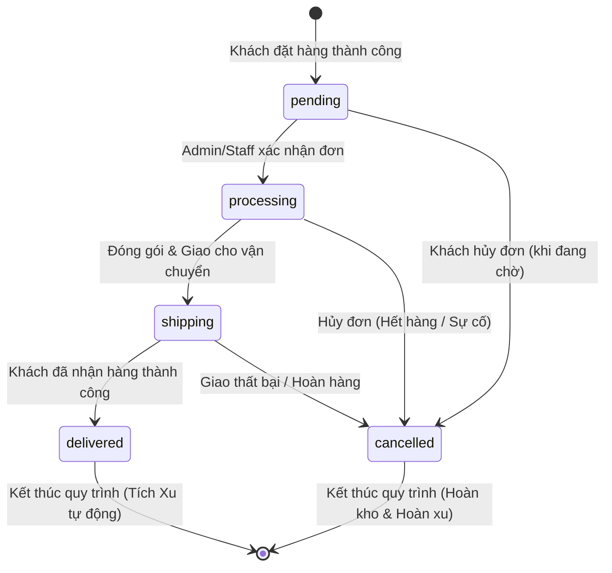
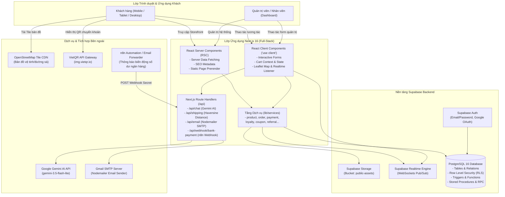
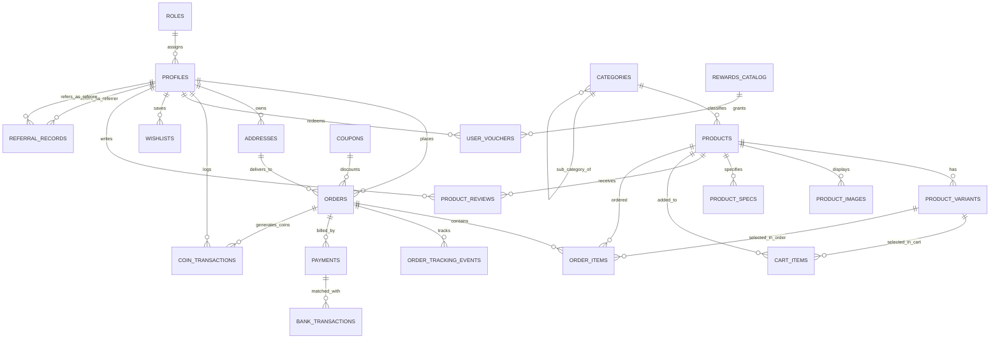
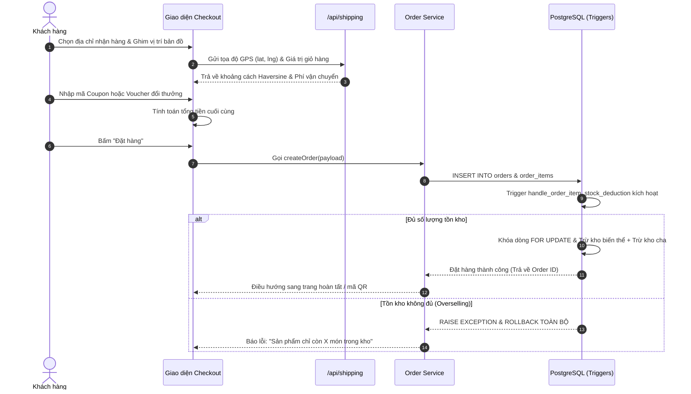
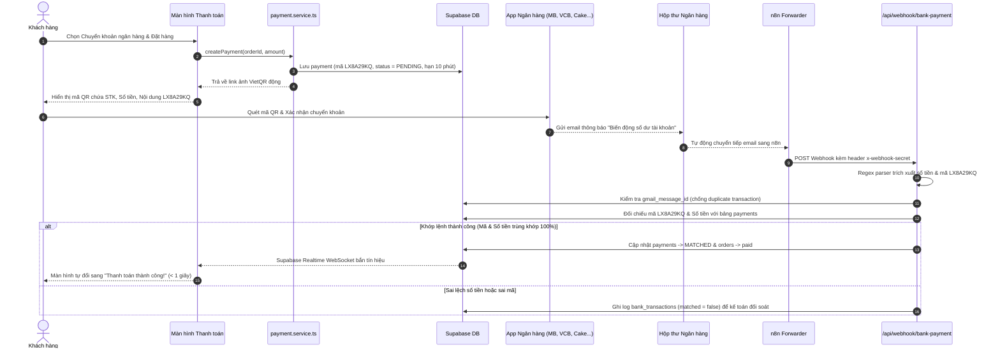

# LUXECOMMERCE PLATFORM

## 📑 MỤC LỤC

1. [Giới thiệu dự án](#1-giới-thiệu-dự-án)
2. [Mục tiêu và phạm vi hệ thống](#2-mục-tiêu-và-phạm-vi-hệ-thống)
3. [Tính năng hệ thống](#3-tính-năng-hệ-thống)
   - [3.1. Storefront (Khách hàng)](#31-storefront-khách-hàng)
   - [3.2. Membership, Loyalty & Referral](#32-membership-loyalty--referral)
   - [3.3. Admin Dashboard (Quản trị viên)](#33-admin-dashboard-quản-trị-viên)
   - [3.4. AI, Bản đồ & Thanh toán tự động](#34-ai-bản-đồ--thanh-toán-tự-động)
4. [Quy tắc nghiệp vụ (Business Rules)](#4-quy-tắc-nghiệp-vụ-business-rules)
   - [4.1. Product & Product Variants](#41-product--product-variants)
   - [4.2. Inventory Management (Quản lý tồn kho)](#42-inventory-management-quản-lý-tồn-kho)
   - [4.3. Cart & Checkout (Giỏ hàng & Đặt hàng)](#43-cart--checkout-giỏ-hàng--đặt-hàng)
   - [4.4. Order Management (Vòng đời đơn hàng)](#44-order-management-vòng-đời-đơn-hàng)
   - [4.5. Payment (Thanh toán VietQR & COD)](#45-payment-thanh-toán-vietqr--cod)
   - [4.6. Coupon & Voucher (Khuyến mại & Quà tặng)](#46-coupon--voucher-khuyến-mại--quà-tặng)
   - [4.7. Wallet & LuxeCoins (Ví xu tích lũy)](#47-wallet--luxecoins-ví-xu-tích-lũy)
   - [4.8. VIP Membership (Hạng thành viên)](#48-vip-membership-hạng-thành-viên)
   - [4.9. Referral Program (Giới thiệu bạn bè)](#49-referral-program-giới-thiệu-bạn-bè)
   - [4.10. Shipping (Vận chuyển & Phí giao hàng)](#410-shipping-vận-chuyển--phí-giao-hàng)
   - [4.11. Wishlist, Reviews & Notifications](#411-wishlist-reviews--notifications)
5. [Kiến trúc hệ thống (System Architecture)](#5-kiến-trúc-hệ-thống-system-architecture)
   - [5.1. Sơ đồ kiến trúc tổng thể](#51-sơ-đồ-kiến-trúc-tổng-thể)
   - [5.2. Phân chia Client-Side và Server-Side](#52-phân-chia-client-side-và-server-side)
   - [5.3. Quản lý Supabase Client & Phiên làm việc](#53-quản-lý-supabase-client--phiên-làm-việc)
6. [Công nghệ sử dụng (Technology Stack)](#6-công-nghệ-sử-dụng-technology-stack)
7. [Kiến trúc thư mục (Project Structure)](#7-kiến-trúc-thư-mục-project-structure)
8. [Thiết kế cơ sở dữ liệu (Database Design)](#8-thiết-kế-cơ-sở-dữ-liệu-database-design)
   - [8.1. Sơ đồ ERD thực thể quan hệ](#81-sơ-đồ-erd-thực-thể-quan-hệ)
   - [8.2. Danh mục bảng & Từ điển dữ liệu (Data Dictionary)](#82-danh-mục-bảng--từ-điển-dữ-liệu-data-dictionary)
   - [8.3. Ràng buộc dữ liệu & Đánh chỉ mục (Indexes)](#83-ràng-buộc-dữ-liệu--đánh-chỉ-mục-indexes)
9. [Database Triggers, Functions & Stored Procedures](#9-database-triggers-functions--stored-procedures)
10. [Danh mục API Route Handlers & Services](#10-danh-mục-api-route-handlers--services)
    - [10.1. API Route Handlers](#101-api-route-handlers)
    - [10.2. Tầng Services (lib/services)](#102-tầng-services-libservices)
11. [Các luồng nghiệp vụ cốt lõi (Core Business Flows)](#11-các-luồng-nghiệp-vụ-cốt-lõi-core-business-flows)
    - [11.1. Luồng Checkout & Trừ kho nguyên tử](#111-luồng-checkout--trừ-kho-nguyên-tử)
    - [11.2. Luồng Thanh toán VietQR & Khớp lệnh Email Ngân hàng](#112-luồng-thanh-toán-vietqr--khớp-lệnh-email-ngân-hàng)
    - [11.3. Luồng Tích Xu & Thăng hạng VIP](#113-luồng-tích-xu--thăng-hạng-vip)
    - [11.4. Luồng Thưởng Giới thiệu bạn bè (Referral)](#114-luồng-thưởng-giới-thiệu-bạn-bè-referral)
    - [11.5. Luồng Đổi Xu lấy Voucher cá nhân](#115-luồng-đổi-xu-lấy-voucher-cá-nhân)
    - [11.6. Luồng Tra cứu Vận đơn công khai](#116-luồng-tra-cứu-vận-đơn-công-khai)
12. [Xác thực & Ma trận Phân quyền (Authentication & RBAC)](#12-xác-thực--ma-trận-phân-quyền-authentication--rbac)
13. [Bảo mật hệ thống (Security Architecture)](#13-bảo-mật-hệ-thống-security-architecture)
14. [Kiểm thử hệ thống (Testing Verification)](#14-kiểm-thử-hệ-thống-testing-verification)
15. [Triển khai & Vận hành (Deployment & Operations)](#15-triển-khai--vận-hành-deployment--operations)
16. [Hạn chế hiện tại & Hướng phát triển (Limitations & Roadmap)](#16-hạn-chế-hiện-tại--hướng-phát-triển-limitations--roadmap)
17. [Hướng dẫn Cài đặt & Chạy Local](#17-hướng-dẫn-cài-đặt--chạy-local)

---

# 1. GIỚI THIỆU DỰ ÁN

<div align="center">
  
  <h3>LUXE COMMERCE PLATFORM</h3>
  <p><strong>Nền tảng Thương mại Điện tử Hàng hiệu & Hệ thống Quản trị Doanh nghiệp Toàn diện</strong></p>
  <p>
    
    
    
    
    
    
    
    
  </p>
</div>

**LuxeCommerce** là giải pháp phần mềm thương mại điện tử chuyên nghiệp, giải quyết bài toán bán lẻ hàng hiệu và quản trị vận hành khép kín cho các doanh nghiệp vừa và nhỏ (SMB). Dự án mở rộng nền tảng từ bộ khung mã nguồn mở `shadcn-admin-dashboard-free`, tái cấu trúc và bổ sung hoàn chỉnh cả hai phân hệ:
1. **Storefront (Khách hàng):** Cửa hàng trực tuyến theo ngôn ngữ thiết kế **Soft Premium**, tập trung vào trải nghiệm mượt mà, sang trọng, tương phản tinh tế, hỗ trợ Dark/Light mode và chuẩn hóa Responsive 100% trên Mobile, Tablet và Desktop.
2. **Enterprise Admin Dashboard (Quản trị):** Phân hệ quản lý đơn hàng, danh mục, sản phẩm biến thể đồng bộ kho theo thời gian thực, quản lý chiến dịch tiếp thị và phân quyền bảo mật nhiều lớp.

---

# 2. MỤC TIÊU VÀ PHẠM VI HỆ THỐNG

### 2.1. Mục tiêu cốt lõi
- **Toàn vẹn dữ liệu giao dịch:** Không bao giờ để xảy ra tình trạng bán vượt tồn kho (overselling) hoặc cộng/trừ xu hai lần khi có nhiều khách hàng đặt hàng cùng lúc.
- **Tự động hóa vận hành:** Giảm thiểu 90% thao tác kế toán xác nhận chuyển khoản ngân hàng qua cơ chế quét mã VietQR và khớp lệnh tự động bằng Webhook phân tích email ngân hàng.
- **Gia tăng vòng đời khách hàng (LTV):** Xây dựng phễu gắn kết khách hàng thông qua Gamification (Hệ thống Xu thưởng, 4 Hạng thành viên VIP, Đổi voucher quà tặng và Cơ chế giới thiệu bạn bè nhận thưởng).

### 2.2. Phạm vi người dùng & Hệ thống
| Phân hệ / Đối tượng | Quyền hạn & Phạm vi truy cập |
|---|---|
| **Khách vãng lai (Guest)** | Duyệt danh mục, tìm kiếm sản phẩm, xem chi tiết, thêm giỏ hàng tạm |
| **Khách hàng thành viên (Customer)** | Đặt hàng, theo dõi đơn hàng, quản lý sản phẩm yêu thích, quản lý sổ địa chỉ theo GPS, tuỳ chỉnh hồ sơ, tích lũy LuxeCoins, thăng hạng VIP, đổi voucher quà tặng, đánh giá sản phẩm, quản lý mã giới thiệu. |
| **Nhân viên vận hành (Staff)** | Tiếp nhận đơn hàng, cập nhật trạng thái vận đơn, quản lý sản phẩm, quản lý khách hàng,  tạo mã giảm giá và banner quảng cáo. Không được xóa dữ liệu nhạy cảm hoặc thay đổi cấu hình bảo mật. |
| **Quản trị viên tối cao (Admin)** | Toàn quyền kiểm soát hệ thống: Quản lý người dùng, phân quyền RBAC, khóa/mở khóa tài khoản, xem báo cáo doanh thu, quản lý sản phẩm/mã giảm giá/banner, gửi thông báo hàng loạt/cá nhân đến email. |

---

# 3. TÍNH NĂNG HỆ THỐNG

Mỗi tính năng được phân định trạng thái rõ ràng theo chuẩn:
- `[Đã triển khai]`: Đã hoàn thiện mã nguồn, kiểm thử và hoạt động ổn định.
- `[Đang hoàn thiện]`: Đã có giao diện hoặc logic nền tảng, đang hoàn thiện tích hợp sâu.
- `[Dự kiến]`: Kế hoạch nâng cấp trong giai đoạn tiếp theo.

### 3.1. Storefront (Khách hàng)
- **Trang chủ & Khám phá `[Đã triển khai]`:**
  - Banner Carousel động đa tầng mượt mà (`embla-carousel-react`).
  - Danh mục hàng hiệu trực quan, danh sách sản phẩm thịnh hành, khuyến mại sốc flashsale.
- **Tìm kiếm & Bộ lọc nâng cao `[Đã triển khai]`:**
  - Tìm kiếm toàn văn (Full-text search) có Debounce 500ms chống nghẽn server.
  - Lọc theo danh mục đa cấp, khoảng giá kéo thả, thương hiệu và sắp xếp độ phổ biến/giá cả.
- **Trang Chi tiết Sản phẩm (Product Details) `[Đã triển khai]`:**
  - Thư viện ảnh sản phẩm tương tác, xem ảnh phóng to.
  - Bộ chọn biến thể thông minh (Màu sắc, Dung lượng, Kích thước) tự đổi SKU và tính giá chênh lệch.
  - Bảng thông số kỹ thuật (Specs) và mô tả chi tiết chuẩn HTML.
  - Đánh giá sao (1-5 sao) và phản hồi từ người mua thực tế.
- **Giỏ hàng Real-time `[Đã triển khai]`:**
  - Tự động đồng bộ số lượng tức thì, cảnh báo ngay khi một biến thể bị vượt quá tồn kho khả dụng.
- **Thanh toán & Chọn địa chỉ bản đồ `[Đã triển khai]`:**
  - Sổ địa chỉ phân loại "Nhà riêng" / "Văn phòng".
  - Tích hợp bản đồ Leaflet & OpenStreetMap ghim vị trí nhận hàng, lưu tọa độ GPS (Vĩ độ / Kinh độ).
  - Tự động tính khoảng cách từ Kho trung tâm theo thuật toán Haversine để áp mức phí ship công bằng.
- **Theo dõi Đơn hàng Công khai (Order Tracking) `[Đã triển khai]`:**
  - Tra cứu bằng Mã đơn hàng UUID, Short ID hoặc Mã thanh toán `LX-xxxxxx`.
  - Hiển thị Timeline từng mốc giao hàng kèm thời gian và mô tả chi tiết.

### 3.2. Membership, Loyalty & Referral
- **Thẻ Thành viên Kỹ thuật số (Digital VIP Card) `[Đã triển khai]`:**
  - 4 Cấp độ: **Đồng (Bronze) $\rightarrow$ Bạc (Silver) $\rightarrow$ Vàng (Gold) $\rightarrow$ Kim Cương (Diamond)** cùng nhận diện riêng cho Admin/Staff sử dụng icon Flaticon độc quyền.
  - Thanh tiến trình trực quan thể hiện khoảng cách tích lũy đến hạng tiếp theo.
- **Ví Xu LuxeCoins `[Đã triển khai]`:**
  - Tự động hoàn Xu vào ví khách hàng khi đơn hàng giao thành công (`status = 'delivered'`).
  - Lịch sử biến động số dư Xu minh bạch (`coin_transactions`).
- **Trung tâm Đổi thưởng (Rewards Center) `[Đã triển khai]`:**
  - Dùng Xu đổi lấy các Voucher giảm giá cá nhân độc quyền (`user_vouchers`).
- **Hệ thống Giới thiệu Bạn bè (Referral Viral Loop) `[Đã triển khai]`:**
  - Mỗi tài khoản có một mã giới thiệu độc nhất dạng `LUXE-XXXXXX`. Hỗ trợ đổi mã giới thiệu 1 lần.
  - Tự động thưởng Xu cho Người giới thiệu khi Bạn bè hoàn thành đơn đầu tiên $\ge 100.000$ VNĐ.
- **Danh sách Yêu thích (Wishlist) `[Đã triển khai]`:**
  - Lưu sản phẩm yêu thích kèm tính năng gom nhóm và ghi chú riêng.

### 3.3. Admin Dashboard (Quản trị viên)
- **Thống kê Kinh doanh (Analytics) `[Đã triển khai]`:**
  - Biểu đồ biến động doanh thu, sản lượng đơn theo thời gian thực (`recharts`).
  - Báo cáo phân bổ trạng thái đơn, top sản phẩm bán chạy.
- **Quản lý Sản phẩm & Tồn kho Biến thể `[Đã triển khai]`:**
  - Soạn thảo mô tả sản phẩm bằng Rich Text Editor (Tiptap / MDX).
  - Tải lên bộ sưu tập ảnh vào Supabase Storage (`public-assets`).
  - **Đồng bộ Tồn kho 2 Chiều:** Thay đổi tồn kho từng biến thể tự động cập nhật tổng tồn kho sản phẩm cha và ngược lại với các nút hành động phân bổ nhanh.
- **Quản lý Vận đơn & Trạng thái Đơn hàng `[Đã triển khai]`:**
  - Cập nhật luân chuyển trạng thái đơn hàng: Chờ duyệt $\rightarrow$ Đang xử lý $\rightarrow$ Đang giao $\rightarrow$ Đã giao $\rightarrow$ Hủy đơn.
  - Lắng nghe đơn hàng mới qua WebSocket Supabase Realtime không cần F5.
- **Quản lý Khuyến mãi, Banner & Phân quyền `[Đã triển khai]`:**
  - Tạo Coupon giảm giá phần trăm hoặc tiền mặt, chặn mức đơn tối thiểu (`min_order_amount`).
  - Quản trị banner trang chủ.
  - Quản lý danh sách người dùng, phân quyền vai trò (Role Assignment) và khóa/xoá tài khoản vi phạm (`is_locked`).
  - Trung tâm phát sóng thông báo (Broadcast Notifications).

### 3.4. AI, Bản đồ & Thanh toán tự động
- **Trợ lý AI Bán hàng (Gemini Chatbot) `[Đã triển khai]`:**
  - Trợ lý thông minh tích hợp Google GenAI SDK (`gemini-3.5-flash-lite` kết hợp fallback `gemini-3.8-flash`).
  - Tự động bóc tách từ khóa tìm kiếm tiếng Việt, truy vấn sản phẩm và mã giảm giá phù hợp trong Supabase làm ngữ cảnh động (RAG) trước khi sinh câu trả lời.
- **Bản đồ Tương tác Leaflet & OpenStreetMap (OSM) `[Đã triển khai]`:**
  - Hiển thị bản đồ, cho phép khách hàng click ghim vị trí chính xác để lấy GPS. Không tốn chi phí API key.
- **Thanh toán VietQR & Khớp lệnh Tự động từ Email Ngân hàng `[Đã triển khai]`:**
  - Tạo ảnh mã VietQR động chuẩn NAPAS chứa số tiền và mã thanh toán duy nhất `LX-xxxxxx`.
  - Webhook tiếp nhận thông báo biến động số dư từ email forwarder, phân tích Regex, kiểm tra trùng lặp và tự động chuyển trạng thái đơn hàng sang `paid` qua Supabase Realtime.
- **Gửi Email Giao dịch qua Nodemailer `[Đã triển khai]`:**
  - Gửi email xác nhận đặt hàng và thông báo giao hàng thành công bằng giao diện HTML responsive chuyên nghiệp qua Gmail SMTP. Ghi nhận nhật ký vào `email_send_logs`.

---

# 4. QUY TẮC NGHIỆP VỤ (BUSINESS RULES)

### 4.1. Product & Product Variants
- **Cấu trúc dữ liệu:** Một sản phẩm (`products`) có thể là sản phẩm đơn (không có biến thể) hoặc sản phẩm có nhiều biến thể con (`product_variants`).
- **Công thức tính giá hiển thị:**
  $$\text{Giá cuối cùng} = (\text{Giá gốc} + \text{Giá cộng thêm của biến thể}) \times \left(1 - \frac{\text{Tỷ lệ giảm giá \%}}{100}\right)$$
  - Ví dụ: Áo khoác giá gốc $1.000.000$ VNĐ, biến thể Màu Đen cộng thêm $+50.000$ VNĐ, sản phẩm đang giảm giá $10\%$:
    $$\text{Giá bán} = (1.000.000 + 50.000) \times 0.9 = 945.000 \text{ VNĐ}$$
- **Quy tắc SKU (Stock Keeping Unit):** Mã SKU được chuẩn hóa thành chữ in hoa không dấu, không chứa khoảng trắng. SKU của từng biến thể là duy nhất trong danh mục sản phẩm của cửa hàng.
- **Điều kiện đánh giá sản phẩm:** Đánh giá (`product_reviews`) gắn liền với tài khoản đã đăng nhập (`user_id = auth.uid()`). Điểm đánh giá bắt buộc từ 1 đến 5 sao kèm nội dung nhận xét.

### 4.2. Inventory Management (Quản lý tồn kho)
- **Công thức đồng bộ:**
  - Khi sản phẩm có biến thể, tổng số lượng tồn kho của sản phẩm cha bắt buộc phải bằng tổng số lượng của các biến thể con:
    $$\text{Tồn kho cha} = \sum_{i=1}^{n} \text{Tồn kho biến thể}_i$$
- **Cơ chế thực thi đa tầng:**
  1. *Tại giao diện (Client):* Khi Admin sửa tồn kho của bất kỳ biến thể nào trong `product-form.tsx`, ô tồn kho chung tự động tính lại ngay lập tức. Nếu Admin tự nhập tồn kho chung bị lệch, giao diện đưa ra cảnh báo hổ phách kèm nút *Cập nhật theo biến thể* hoặc *Chia đều vào biến thể*.
  2. *Tại tầng Database (Atomic Protection):*
     - Khi khách đặt đơn, trigger `trg_deduct_stock_on_order_item` kích hoạt **BEFORE INSERT** trên bảng `order_items`:
       - Dùng `SELECT ... FOR UPDATE` khóa chặt dòng sản phẩm/biến thể tương ứng.
       - Nếu tồn kho khả dụng $< \text{Số lượng đặt mua}$, CSDL sẽ chủ động **BẮN LỖI (RAISE EXCEPTION)** và **ROLLBACK** toàn bộ giao dịch, triệt tiêu 100% nguy cơ bán vượt tồn kho (overselling) khi có tranh chấp đồng thời.
       - Trừ tồn kho biến thể và đồng thời trừ tồn kho sản phẩm cha.
- **Hoàn trả tồn kho khi Hủy đơn:**
  - Trigger `trg_restore_stock_on_order_cancellation` kích hoạt **AFTER UPDATE** trên bảng `orders`:
  - Khi trạng thái chuyển sang `cancelled`, CSDL tự động duyệt qua tất cả `order_items` của đơn hàng đó và cộng hoàn trả lại số lượng chính xác vào cả biến thể và sản phẩm cha.

### 4.3. Cart & Checkout (Giỏ hàng & Đặt hàng)
- **Lưu trữ giỏ hàng:** Dữ liệu giỏ hàng được quản lý bền vững trên bảng `cart_items` trong CSDL liên kết theo `user_id` và `variant_id`.
- **Kiểm tra tồn kho thời gian thực:** Khách hàng không thể thêm vào giỏ hàng số lượng vượt quá số lượng tồn kho thực tế của biến thể đó tại thời điểm bấm chọn.
- **Điều kiện thanh toán:** Khách hàng bắt buộc phải có thông tin Người nhận, Số điện thoại hợp lệ và Địa chỉ giao hàng đã được xác định tọa độ GPS để tính cước phí.

### 4.4. Order Management (Vòng đời đơn hàng)
Đơn hàng trong hệ thống tuân theo máy trạng thái hữu hạn (State Machine) nghiêm ngặt:



| Trạng thái | Ý nghĩa | Quyền cập nhật | Tác động phụ kèm theo |
|---|---|---|---|
| `pending` | Đơn hàng mới tạo, đang chờ xác nhận | Hệ thống | Trừ tồn kho tức thì qua Trigger `order_items` |
| `processing` | Đã xác nhận thông tin, đang gom hàng | Staff / Admin | Không |
| `shipping` | Đã xuất kho, tài xế đang giao | Staff / Admin | Tự động tạo mốc sự kiện vận đơn `order_tracking_events` |
| `delivered` | Giao thành công, khách đã nhận | Staff / Admin | Tự động cộng Xu thưởng cho khách và kiểm tra thưởng Referral |
| `cancelled` | Đơn hàng bị hủy bỏ | Khách (khi pending) / Staff / Admin | Tự động hoàn lại số lượng tồn kho và hoàn trả lại Xu khách đã dùng |

### 4.5. Payment (Thanh toán VietQR & COD)
- **COD (Thanh toán khi nhận hàng):** Đơn hàng giữ `payment_status = 'pending'`, chỉ chuyển `paid` khi trạng thái đơn đổi thành `delivered`.
- **Chuyển khoản Ngân hàng tự động (VietQR):**
  - Sinh mã thanh toán ngẫu nhiên dạng `LX-xxxxxx` (ví dụ: `LX8A29KQ`) với bảng ký tự loại trừ các ký tự dễ nhầm lẫn: `ABCDEFGHJKLMNPQRSTUVWXYZ23456789`.
  - Phiên thanh toán lưu trong bảng `payments` với thời hạn chính xác **10 phút** (`expires_at = NOW() + INTERVAL '10 minutes'`).
  - Tạo mã ảnh VietQR chuẩn NAPAS chứa chính xác: Mã ngân hàng, Số tài khoản nhận, Tên tài khoản, Số tiền và Nội dung thanh toán là mã `LXxxxxxx`.
  - Nếu quá 10 phút khách không chuyển tiền, phiên thanh toán tự hết hạn.

### 4.6. Coupon & Voucher (Khuyến mại & Quà tặng)
- **Phân biệt Coupon và Voucher:**
  - **Coupon (`coupons`):** Là mã khuyến mãi dùng chung cho các chiến dịch marketing do Admin phát hành (ví dụ: `LUXE10`, `WELCOME2026`). Có số lượt sử dụng tối đa (`usage_limit`), số lần đã dùng (`used_count`), ngày hết hạn (`valid_until`) và điều kiện đơn hàng tối thiểu (`min_order_amount`).
  - **Voucher (`user_vouchers`):** Là phiếu giảm giá cá nhân do khách hàng tự dùng Xu tích lũy để đổi từ `rewards_catalog`. Mỗi voucher sở hữu một mã riêng dạng `REW-XXXXXXXX`, gắn chặt với `user_id` của khách, có hạn dùng 30 ngày và chỉ được sử dụng một lần duy nhất (`is_used = true`).
- **Quy tắc áp dụng:** Mỗi đơn hàng chỉ được áp dụng 1 mã Coupon hoặc 1 Voucher tại một thời điểm, kết hợp cùng số lượng Xu muốn tiêu trừ.

### 4.7. Wallet & LuxeCoins (Ví xu tích lũy)
- **Nơi lưu trữ:**
  - Số dư khả dụng: Cột `coins_balance` trên bảng `profiles` (ràng buộc `CHECK coins_balance >= 0`).
  - Tổng số xu tích lũy trọn đời: Cột `lifetime_coins` trên bảng `profiles`.
  - Lịch sử biến động: Bảng `coin_transactions`.
- **Tỷ lệ tích Xu thưởng khi hoàn tất đơn hàng:**
  - Tỷ lệ tích xu phụ thuộc vào Hạng thành viên của khách hàng:
    - **Hạng Đồng (Bronze):** Tích **$1.0\%$**
    - **Hạng Bạc (Silver):** Tích **$1.5\%$**
    - **Hạng Vàng (Gold):** Tích **$2.0\%$**
    - **Hạng Kim Cương (Diamond):** Tích **$3.0\%$**
  - Công thức tính xu thưởng (làm tròn xuống):
    $$\text{Xu nhận} = \left\lfloor (\text{Tổng giá trị đơn} - \text{Phí giao hàng}) \times \text{Tỷ lệ tích xu} \right\rfloor$$
  - Giá trị quy đổi: $1 \text{ Xu} = 1 \text{ VNĐ}$ khi giảm trừ vào đơn hàng tiếp theo.
- **Chống gian lận & chạy lặp:** Trigger `trg_award_coins_on_order_delivered` kiểm tra điều kiện `coins_earned = 0` trước khi cộng. Sau khi cộng, ghi nhận `NEW.coins_earned = v_coins_to_award` để đảm bảo dù đơn hàng có bị cập nhật nhiều lần thì cũng chỉ được nhận thưởng đúng một lần duy nhất.

### 4.8. VIP Membership (Hạng thành viên)
- Hạng thành viên được quản lý tự động bởi CSDL dựa trên chỉ số `lifetime_coins` (tổng xu tích lũy từ trước đến nay, không bị giảm đi khi tiêu xài xu):

| Hạng VIP | Ngưỡng tích lũy (`lifetime_coins`) | Ước tính chi tiêu tối thiểu | Tỷ lệ tích xu | Thưởng giới thiệu bạn bè |
|---|---|---|---|---|
| **Đồng (Bronze)** | $0 - 4.999$ điểm | Mặc định khi đăng ký | $1.0\%$ | $+10.000$ Xu |
| **Bạc (Silver)** | $5.000 - 19.999$ điểm | Từ $500.000$ VNĐ | $1.5\%$ | $+12.000$ Xu |
| **Vàng (Gold)** | $20.000 - 49.999$ điểm | Từ $2.000.000$ VNĐ | $2.0\%$ | $+15.000$ Xu |
| **Kim Cương (Diamond)** | $\ge 50.000$ điểm | Từ $5.000.000$ VNĐ | $3.0\%$ | $+20.000$ Xu |

- **Cơ chế nâng hạng:** Trigger `trg_profiles_membership_tier` kích hoạt **BEFORE INSERT OR UPDATE OF lifetime_coins** trên bảng `profiles`, tự động gọi hàm `calc_membership_tier()` để gán lại hạng. Hạng thành viên được duy trì trọn đời, không bị hạ hạng khi tiêu xu đổi quà.

### 4.9. Referral Program (Giới thiệu bạn bè)
- **Cơ chế cấp mã:** Mọi tài khoản khi tạo thành công đều được gán tự động một mã giới thiệu ngẫu nhiên duy nhất qua hàm `generate_unique_referral_code()` (dạng `LUXE-` + 6 ký tự hex, ví dụ `LUXE-363F88`).
- **Tùy chỉnh mã (Vanity Code):** Khách hàng được phép tự đổi mã giới thiệu của mình 1 lần duy nhất qua Stored Procedure `customize_referral_code(p_new_code)`.
- **Ràng buộc chống gian lận:**
  - `chk_no_self_referral`: Người dùng tuyệt đối không thể tự nhập mã giới thiệu của chính mình (`referrer_id != referee_id`).
  - `uq_referee`: Mỗi tài khoản chỉ được người khác giới thiệu đúng 1 lần duy nhất.
- **Điều kiện nhận thưởng:**
  - Người được giới thiệu (Referee) phải đặt và nhận đơn hàng đầu tiên có giá trị $\ge 100.000$ VNĐ (`v_qualifying_threshold`).
  - Khi đơn hàng hoàn thành (`status = 'delivered'`), hệ thống tự động:
    1. Đổi trạng thái bản ghi `referral_records` sang `'rewarded'`.
    2. Cộng Xu thưởng vào tài khoản Người giới thiệu tương ứng theo Hạng VIP ($10.000$ đến $20.000$ Xu).
    3. Tăng bộ đếm `referral_count` thêm 1.
    4. Gửi thông báo chuông (Notification) cho Người giới thiệu.

### 4.10. Shipping (Vận chuyển & Phí giao hàng)
- **Tọa độ Kho trung tâm LuxeCommerce:** Thiết lập tại Quận 1, TP. Hồ Chí Minh (`lat: 10.7769`, `lng: 106.7009`).
- **Thuật toán tính khoảng cách Haversine:**
  $$\Delta \sigma = 2 \arcsin \left( \sqrt{\sin^2\left(\frac{\Delta \phi}{2}\right) + \cos(\phi_1)\cos(\phi_2)\sin^2\left(\frac{\Delta \lambda}{2}\right)} \right)$$
  $$\text{Khoảng cách thực tế (km)} = R \times \Delta \sigma \times 1.35$$
  *(Trong đó $R = 6371\text{ km}$, hệ số $1.35$ bù đắp cho đường sá uốn lượn tại đô thị Việt Nam so với đường chim bay).*
- **Biểu phí vận chuyển:**
  - **Dưới 5 km (Nội thành gần):** $15.000$ VNĐ — Giao Hỏa tốc ($2 - 4$ giờ).
  - **Từ 5 đến 15 km (Nội thành mở rộng):** $25.000 \text{ VNĐ} + (\text{Số km} - 5) \times 1.500 \text{ VNĐ}$ — Trong ngày ($4 - 8$ giờ).
  - **Từ 15 đến 35 km (Ngoại thành):** $35.000 \text{ VNĐ} + (\text{Số km} - 15) \times 1.200 \text{ VNĐ}$ — Tiêu chuẩn ($1 - 2$ ngày).
  - **Trên 35 km (Liên tỉnh):** $45.000 \text{ VNĐ} + (\text{Số km} - 35) \times 800 \text{ VNĐ}$ (Áp dụng mức trần tối đa $80.000$ VNĐ).
  - **Chính sách Freeship:** Miễn phí vận chuyển $100\%$ cho tất cả đơn hàng có giá trị tiền hàng từ **$500.000$ VNĐ** trở lên (`FREE_SHIPPING_THRESHOLD`).

### 4.11. Wishlist, Reviews & Notifications
- **Danh sách Yêu thích (`wishlists`):** Cho phép người dùng gắn cờ lưu sản phẩm quan tâm, hỗ trợ gom cụm theo `group_name` (ví dụ: "Đồ đi tiệc", "Đồ công nghệ") và ghi chú cá nhân.
- **Thông báo (`notifications`):** Hỗ trợ thông báo cá nhân (`user_id = auth.uid()`) và thông báo phát sóng chung toàn sàn (`is_broadcast = true`).

---

# 5. KIẾN TRÚC HỆ THỐNG (SYSTEM ARCHITECTURE)

### 5.1. Sơ đồ kiến trúc tổng thể



### 5.2. Phân chia Client-Side và Server-Side
- **Server Components (Mặc định):** Sử dụng cho toàn bộ các trang hiển thị dữ liệu đọc (Read-heavy) như Danh sách sản phẩm, Trang chi tiết sản phẩm, Danh mục, Lịch sử đơn hàng để tối ưu hóa SEO và tốc độ tải trang ban đầu (FCP < 1.0s).
- **Client Components (`"use client"`):** Thu hẹp tối đa tại các thành phần có tính tương tác cao:
  - Bộ chọn biến thể và giỏ hàng (`components/storefront/product-variants.tsx`).
  - Bản đồ Leaflet tương tác (`components/storefront/address-map-view.tsx`).
  - Form thêm/sửa sản phẩm đồng bộ tồn kho (`components/admin/product-form.tsx`).
  - Trình nghe WebSocket Realtime cập nhật đơn hàng và thanh toán.

### 5.3. Quản lý Supabase Client & Phiên làm việc
Hệ thống phân tách triệt để 2 loại client nhằm đảm bảo an toàn tuyệt đối:
1. **Public Client (`lib/supabase/client.ts`):**
   - Khởi tạo qua `createClient(NEXT_PUBLIC_SUPABASE_URL, NEXT_PUBLIC_SUPABASE_ANON_KEY)`.
   - Chạy trên trình duyệt của người dùng, tôn trọng $100\%$ các chính sách Row Level Security (RLS). Mọi câu truy vấn đều được tự động xác thực danh tính qua cookie/token của `auth.uid()`.
2. **Admin Service Client (`lib/supabase/admin.ts`):**
   - Khởi tạo qua `createClient(SUPABASE_URL, SUPABASE_SERVICE_ROLE_KEY)`.
   - **Chỉ được phép thực thi trong môi trường máy chủ (Server-side Route Handlers)**. Bỏ qua RLS để thực hiện các thao tác quản trị đặc quyền như: Nhận Webhook thanh toán từ ngân hàng, hoàn tất giao dịch tự động, gửi email hàng loạt.

---

# 6. CÔNG NGHỆ SỬ DỤNG (TECHNOLOGY STACK)

Bảng đối chiếu chuẩn xác $100\%$ với các gói phụ thuộc được khai báo tại `package.json`:

| Phân loại | Tên công nghệ | Phiên bản | Mục đích & Trách nhiệm trong dự án |
|---|---|---|---|
| **Core Framework** | [Next.js](https://nextjs.org/) | `16.1.0` | App Router, React Server Components, Server Actions, Turbopack |
| **Frontend Library** | [React](https://react.dev/) | `19.2.3` | Thư viện nền tảng xây dựng giao diện người dùng |
| **Ngôn ngữ** | [TypeScript](https://www.typescriptlang.org/) | `5.9.3` | Kiểm soát kiểu dữ liệu tĩnh nghiêm ngặt trên toàn hệ thống |
| **Styling Engine** | [Tailwind CSS](https://tailwindcss.com/) | `v4.1.18` | CSS Framework thế hệ mới, tối ưu hóa bundle CSS theo phong cách Soft Premium |
| **UI Components** | [shadcn/ui](https://ui.shadcn.com/) / Radix UI | Latest | Bộ primitive components chuẩn Accessibility (WAI-ARIA) |
| **Icons** | Tabler Icons & Lucide | `^3.36.0` / `^0.379.0` | Hệ thống biểu tượng giao diện và thanh công cụ |
| **Backend / CSDL** | [Supabase](https://supabase.com/) | `^2.108.1` | PostgreSQL 16, Row Level Security, Realtime WebSocket, Storage |
| **Trí tuệ nhân tạo** | [Google GenAI SDK](https://www.npmjs.com/package/@google/genai) | `^2.30.0` | Tích hợp mô hình Gemini 3.5 Flash Lite và Gemini 3.8 Flash |
| **Bản đồ trực quan** | [Leaflet](https://leafletjs.com/) | `^1.9.4` | Bản đồ tương tác ghim vị trí giao hàng và vẽ lộ trình vận chuyển |
| **Bản đồ dữ liệu** | [OpenStreetMap (OSM)](https://www.openstreetmap.org/) | CDN | Nguồn Tile Layer bản đồ miễn phí, không tốn chi phí API key |
| **Thanh toán QR** | [VietQR Gateway](https://vietqr.io/) | API | Tạo ảnh mã QR động chuẩn NAPAS ngân hàng Việt Nam |
| **Email Service** | [Nodemailer](https://nodemailer.com/) | `^9.0.3` | Gửi email giao dịch tự động qua giao thức Gmail SMTP |
| **Trình soạn thảo** | [TipTap](https://tiptap.dev/) / MDX Editor | `^3.27.1` / `^3.52.1` | Soạn thảo mô tả chi tiết sản phẩm chuẩn HTML chuyên nghiệp |
| **Biểu đồ thống kê** | [Recharts](https://recharts.org/) | `2.15.4` | Vẽ biểu đồ doanh thu và phân tích đơn hàng trong Dashboard |
| **Quản lý gói** | [pnpm](https://pnpm.io/) | `^9.x` | Quản lý dependencies với cơ chế liên kết cứng tiết kiệm ổ cứng |

---

# 7. KIẾN TRÚC THƯ MỤC (PROJECT STRUCTURE)

```text
luxecommerce-platform/
├── app/                                        # Next.js App Router (Phân luồng định tuyến)
│   ├── (guest)/                                # Nhóm định tuyến cho khách vãng lai
│   │   ├── login/                              # Màn hình Đăng nhập (Email/Password, Google OAuth)
│   │   ├── register/                           # Màn hình Đăng ký tài khoản mới
│   │   ├── 404-page/                           # Trang báo lỗi 404 tùy biến
│   │   └── 500-page/                           # Trang báo lỗi 500 sự cố máy chủ
│   ├── (storefront)/                           # Nhóm định tuyến Cửa hàng trực tuyến
│   │   ├── account/                            # Cổng thông tin khách hàng cá nhân
│   │   │   ├── addresses/                      # Sổ địa chỉ giao hàng kèm GPS
│   │   │   ├── coins/                          # Ví Xu LuxeCoins & Lịch sử biến động
│   │   │   ├── orders/                         # Lịch sử đơn hàng, xem chi tiết & hủy đơn
│   │   │   ├── referral/                       # Chương trình Giới thiệu bạn bè
│   │   │   ├── rewards/                        # Trung tâm Đổi Xu lấy Voucher
│   │   │   ├── wishlist/                       # Danh sách sản phẩm yêu thích
│   │   │   └── layout.tsx                      # Layout thanh điều hướng tài khoản cá nhân
│   │   ├── cart/                               # Trang Giỏ hàng trực tuyến
│   │   ├── checkout/                           # Trang Thanh toán, chọn địa chỉ & VietQR
│   │   ├── product/[id]/                       # Trang Chi tiết sản phẩm, thư viện ảnh & biến thể
│   │   ├── products/                           # Trang Khám phá sản phẩm kèm bộ lọc đa tiêu chí
│   │   ├── tracking/[code]/                    # Tra cứu hành trình vận chuyển công khai
│   │   └── page.tsx                            # Trang chủ LuxeCommerce (Hero, Carousel, Catalog)
│   ├── api/                                    # Next.js Route Handlers (Server Endpoints)
│   │   ├── chat/route.ts                       # API Trợ lý ảo Gemini AI Chatbot
│   │   ├── email/                              # API gửi email (order-confirmation, delivered, bulk)
│   │   ├── shipping/route.ts                   # API tính cước vận chuyển theo khoảng cách GPS
│   │   └── webhook/bank-payment/route.ts       # Webhook nhận thông báo biến động số dư ngân hàng
│   ├── dashboard/                              # Bảng điều khiển Quản trị (Admin / Staff)
│   │   ├── categories/                         # Quản lý danh mục hàng hóa
│   │   ├── coupons/                            # Quản lý mã giảm giá khuyến mãi
│   │   ├── notifications/                      # Quản lý và phát thông báo toàn sàn
│   │   ├── orders/                             # Quản lý và xử lý quy trình đơn hàng
│   │   ├── products/                           # Quản lý sản phẩm, biến thể & tồn kho
│   │   ├── promo-banners/                      # Quản lý banner quảng cáo trang chủ
│   │   ├── roles/                              # Ma trận phân quyền vai trò người dùng
│   │   ├── settings/                           # Cài đặt cấu hình cửa hàng
│   │   └── users/                              # Quản trị danh sách người dùng & khóa tài khoản
│   ├── globals.css                             # Cấu hình Tailwind CSS v4 & Biến giao diện CSS Tokens
│   └── layout.tsx                              # Root Layout toàn hệ thống (Font, Provider, Toaster)
├── components/                                 # Thư viện UI Components tái sử dụng
│   ├── admin/                                  # Component bảng điều khiển (product-form, metrics...)
│   ├── providers/                              # Context Providers (Auth, Theme, TopLoader)
│   ├── storefront/                             # Component cửa hàng (Header, Footer, VIP Card, Map...)
│   └── ui/                                     # Primitives shadcn/ui (Button, Dialog, Input, Popover...)
├── lib/
│   ├── email/                                  # Cấu hình Nodemailer & Mẫu Email HTML giao dịch
│   ├── gemini/                                 # Khởi tạo Singleton GoogleGenAI Client
│   ├── services/                               # Tầng nghiệp vụ xử lý dữ liệu (24 Business Services)
│   ├── supabase/                               # Khởi tạo Supabase Browser Client & Service Role Client
│   └── utils.ts                                # Hàm tiện ích chung (Format VNĐ, ghép class cn...)
├── public/                                     # Tài nguyên tĩnh (Hình ảnh, Icons, Huy hiệu VIP PNG)
├── supabase/
│   └── migrations/                             # 43 tệp SQL Migration có kiểm soát phiên bản
└── types/                                      # Định nghĩa TypeScript Types toàn hệ thống
```

---

# 8. THIẾT KẾ CƠ SỞ DỮ LIỆU (DATABASE DESIGN)

### 8.1. Sơ đồ ERD thực thể quan hệ



### 8.2. Danh mục bảng & Từ điển dữ liệu (Data Dictionary)

Hệ thống vận hành trên **22 bảng dữ liệu quan hệ** trong lược đồ `public`:

#### 1. Bảng `profiles` (Hồ sơ người dùng)
| Tên cột | Kiểu dữ liệu | Khóa/Ràng buộc | Giá trị mặc định | Diễn giải ý nghĩa |
|---|---|---|---|---|
| `id` | `UUID` | PK, FK $\rightarrow$ `auth.users.id` | None | Mã định danh người dùng từ Supabase Auth |
| `email` | `TEXT` | NOT NULL | None | Địa chỉ thư điện tử |
| `full_name` | `TEXT` | Nullable | None | Họ và tên khách hàng |
| `avatar_url` | `TEXT` | Nullable | None | Đường dẫn ảnh đại diện (hỗ trợ sync từ Google OAuth) |
| `phone` | `VARCHAR(20)` | Nullable | None | Số điện thoại liên hệ |
| `role_id` | `UUID` | FK $\rightarrow$ `roles.id` | None | Vai trò người dùng (`admin`, `staff`, `customer`) |
| `coins_balance`| `INT` | CHECK $\ge 0$ | `0` | Số dư Xu tích lũy khả dụng hiện tại |
| `lifetime_coins`| `INT` | CHECK $\ge 0$ | `0` | Tổng số Xu tích lũy trọn đời (dùng xét hạng VIP) |
| `membership_tier`| `VARCHAR(20)`| CHECK in (`bronze`, `silver`, `gold`, `diamond`) | `'bronze'` | Hạng thành viên VIP |
| `referral_code`| `VARCHAR(30)` | UNIQUE | None | Mã giới thiệu cá nhân độc nhất |
| `referred_by` | `UUID` | FK $\rightarrow$ `profiles.id` | NULL | Người đã giới thiệu tài khoản này |
| `referral_count`| `INT` | CHECK $\ge 0$ | `0` | Số lượng bạn bè đã giới thiệu thành công |
| `has_customized_referral_code`| `BOOLEAN` | NOT NULL | `FALSE` | Cờ đánh dấu đã đổi mã giới thiệu 1 lần hay chưa |
| `is_locked` | `BOOLEAN` | NOT NULL | `FALSE` | Trạng thái khóa tài khoản do Admin xử lý |
| `created_at` | `TIMESTAMPTZ` | NOT NULL | `NOW()` | Thời gian tạo tài khoản |

#### 2. Bảng `products` (Sản phẩm)
| Tên cột | Kiểu dữ liệu | Khóa/Ràng buộc | Giá trị mặc định | Diễn giải ý nghĩa |
|---|---|---|---|---|
| `id` | `UUID` | PK | `gen_random_uuid()` | Mã định danh sản phẩm |
| `name` | `TEXT` | NOT NULL | None | Tên sản phẩm hàng hiệu |
| `price` | `NUMERIC(15,2)` | CHECK $> 0$ | None | Giá niêm yết gốc (VNĐ) |
| `image_url` | `TEXT` | Nullable | None | Ảnh đại diện chính của sản phẩm |
| `category_id` | `UUID` | FK $\rightarrow$ `categories.id` | NULL | Danh mục phân loại |
| `discount_percent`| `INT` | CHECK $0 \le x \le 100$ | `0` | Tỷ lệ giảm giá (%) |
| `stock_quantity` | `INT` | CHECK $\ge 0$ | `0` | Tổng số lượng tồn kho (tự đồng bộ từ các biến thể) |
| `brand` | `VARCHAR(100)` | Nullable | None | Thương hiệu sản xuất |
| `description_html`| `TEXT` | Nullable | None | Nội dung bài viết mô tả chi tiết chuẩn HTML |
| `created_by` | `UUID` | FK $\rightarrow$ `profiles.id` | None | Tài khoản nhân viên/admin tạo sản phẩm |
| `created_at` | `TIMESTAMPTZ` | NOT NULL | `NOW()` | Thời gian đăng bán |

#### 3. Bảng `product_variants` (Biến thể sản phẩm)
| Tên cột | Kiểu dữ liệu | Khóa/Ràng buộc | Giá trị mặc định | Diễn giải ý nghĩa |
|---|---|---|---|---|
| `id` | `UUID` | PK | `gen_random_uuid()` | Mã biến thể |
| `product_id` | `UUID` | FK $\rightarrow$ `products.id` ON DELETE CASCADE | None | Sản phẩm cha trực thuộc |
| `name` | `TEXT` | NOT NULL | None | Tên biến thể (VD: "Màu Đen - 256GB") |
| `sku` | `VARCHAR(50)` | Nullable | None | Mã quản lý kho hàng hóa |
| `price_modifier` | `NUMERIC(15,2)` | NOT NULL | `0` | Số tiền chênh lệch cộng thêm so với giá gốc |
| `stock_quantity` | `INT` | CHECK $\ge 0$ | `0` | Số lượng tồn kho thực tế của riêng biến thể này |

#### 4. Bảng `orders` (Đơn hàng)
| Tên cột | Kiểu dữ liệu | Khóa/Ràng buộc | Giá trị mặc định | Diễn giải ý nghĩa |
|---|---|---|---|---|
| `id` | `UUID` | PK | `gen_random_uuid()` | Mã đơn hàng |
| `user_id` | `UUID` | FK $\rightarrow$ `profiles.id` ON DELETE SET NULL | NULL | Tài khoản đặt đơn (NULL nếu khách vãng lai) |
| `total_amount` | `NUMERIC(15,2)` | CHECK $\ge 0$ | None | Tổng số tiền thanh toán cuối cùng của đơn hàng |
| `shipping_fee` | `NUMERIC(15,2)` | CHECK $\ge 0$ | `0` | Cước phí vận chuyển tính theo cự ly GPS |
| `discount_amount`| `NUMERIC(15,2)` | CHECK $\ge 0$ | `0` | Số tiền được giảm từ Coupon/Voucher |
| `coins_used` | `INT` | CHECK $\ge 0$ | `0` | Số Xu khách hàng đã tiêu trừ cho đơn hàng |
| `coins_discount` | `NUMERIC(15,2)` | CHECK $\ge 0$ | `0` | Số tiền giảm tương ứng từ Xu ($1 \text{ Xu} = 1 \text{ VNĐ}$) |
| `coins_earned` | `INT` | CHECK $\ge 0$ | `0` | Số Xu thưởng thực tế khách được nhận khi giao hàng |
| `status` | `VARCHAR(20)` | CHECK in (`pending`, `processing`, `shipping`, `delivered`, `cancelled`) | `'pending'` | Trạng thái vòng đời đơn hàng |
| `payment_status` | `VARCHAR(20)` | CHECK in (`pending`, `paid`, `failed`) | `'pending'` | Trạng thái thanh toán của đơn hàng |
| `payment_method` | `VARCHAR(20)` | CHECK in (`cod`, `bank_transfer`) | `'cod'` | Phương thức thanh toán lựa chọn |
| `shipping_address_id` | `UUID` | FK $\rightarrow$ `addresses.id` | None | Địa chỉ nhận hàng |
| `created_at` | `TIMESTAMPTZ` | NOT NULL | `NOW()` | Thời gian tạo đơn |

#### 5. Bảng `payments` & `bank_transactions` (Cơ chế khớp lệnh ngân hàng)
- `payments`: Quản lý các phiên thanh toán chuyển khoản của từng đơn hàng.
  - `id (UUID PK)`, `order_id (UUID FK)`, `payment_code (VARCHAR UNIQUE)` (dạng `LX-xxxxxx`), `amount (NUMERIC)`, `status` (`PENDING`, `MATCHED`, `FAILED`, `EXPIRED`, `MANUAL`), `expires_at (TIMESTAMPTZ)` (thời hạn 10 phút), `paid_at (TIMESTAMPTZ)`.
- `bank_transactions`: Nhật ký giao dịch nhận được từ Webhook biến động số dư ngân hàng.
  - `id (UUID PK)`, `gmail_message_id (TEXT UNIQUE)` (khóa chống trùng lặp), `sender_name (TEXT)`, `amount (NUMERIC)`, `description (TEXT)`, `transaction_time (TIMESTAMPTZ)`, `matched (BOOLEAN)`.

#### 6. Các bảng Loyalty & Tiếp thị
- `coin_transactions`: Nhật ký biến động xu (`user_id`, `order_id`, `amount`, `balance_after`, `type`, `description`). `type` gồm: `order_reward`, `order_spent`, `order_refund`, `daily_checkin`, `review_reward`, `referral_reward`, `reward_exchange`, `admin_adjustment`.
- `rewards_catalog`: Danh mục quà tặng (`title`, `discount_amount`, `min_order_amount`, `coin_cost`, `required_tier`, `stock_limit`, `redeemed_count`, `valid_days`).
- `user_vouchers`: Ví voucher cá nhân của người dùng (`user_id`, `reward_id`, `code` dạng `REW-XXXXXXXX`, `discount_amount`, `min_order_amount`, `is_used`, `expires_at`).
- `referral_records`: Ghi nhận quan hệ giới thiệu (`referrer_id`, `referee_id`, `status` in `registered`, `rewarded`, `cancelled`, `qualifying_order_id`, `reward_coins`).
- `coupons`: Mã giảm giá toàn sàn (`code`, `discount_percent`, `min_order_amount`, `usage_limit`, `used_count`, `valid_until`, `is_active`).

### 8.3. Ràng buộc dữ liệu & Đánh chỉ mục (Indexes)
- **Ràng buộc toàn vẹn:**
  - `chk_no_self_referral CHECK (referrer_id != referee_id)`: Không cho phép tự giới thiệu chính mình.
  - `uq_referee UNIQUE (referee_id)`: Một khách hàng chỉ có thể được người khác giới thiệu một lần duy nhất.
  - `CHECK (coins_balance >= 0)`: Tuyệt đối không cho phép số dư Xu bị âm dưới bất kỳ tình huống nào.
- **Tối ưu hóa chỉ mục (Indexes):**
  - Chỉ mục tổng hợp tìm kiếm giao dịch xu: `CREATE INDEX idx_coin_transactions_user_id ON coin_transactions (user_id, created_at DESC);`
  - Chỉ mục đơn hàng người dùng: `CREATE INDEX idx_orders_user_created ON orders (user_id, created_at DESC);`
  - Chỉ mục mã giới thiệu: `CREATE INDEX idx_profiles_referral_code ON profiles (referral_code);`
  - Chỉ mục chống trùng lặp webhook: `CREATE UNIQUE INDEX idx_bank_transactions_msg_id ON bank_transactions (gmail_message_id);`

---

# 9. DATABASE TRIGGERS, FUNCTIONS & STORED PROCEDURES

Bảng thống kê toàn bộ các Trigger và Stored Procedure đang chạy trong hệ thống PostgreSQL:

| Tên Trigger / Function | Bảng tác động | Thời điểm kích hoạt | Mục đích & Trách nhiệm nghiệp vụ | Migration File |
|---|---|---|---|---|
| `trg_deduct_stock_on_order_item` | `order_items` | `BEFORE INSERT` | Khóa dòng `FOR UPDATE`, kiểm tra tồn kho và trừ kho tức thì. Bắn exception rollback nếu thiếu hàng | `20261021121000_inventory_stock_triggers.sql` |
| `trg_restore_stock_on_order_cancellation` | `orders` | `AFTER UPDATE OF status` | Khi trạng thái đơn đổi thành `cancelled`, tự động hoàn trả số lượng lại cho các biến thể và sản phẩm | `20261021121000_inventory_stock_triggers.sql` |
| `trg_award_coins_on_order_delivered` | `orders` | `AFTER UPDATE OF status` | Khi đơn chuyển sang `delivered`, tính và thưởng Xu theo Hạng VIP, đồng thời kiểm tra kích hoạt thưởng Referral | `20261028011000_create_loyalty_and_membership_tiers.sql` |
| `trg_profiles_membership_tier` | `profiles` | `BEFORE INSERT OR UPDATE OF lifetime_coins` | Tự động phân loại và cập nhật `membership_tier` dựa trên số điểm tích lũy trọn đời `lifetime_coins` | `20261028011000_create_loyalty_and_membership_tiers.sql` |
| `trg_profiles_assign_referral_code` | `profiles` | `BEFORE INSERT` | Tự động sinh mã `LUXE-XXXXXX` duy nhất gán cho tài khoản mới khi đăng ký | `20261101000000_create_referral_system.sql` |
| `handle_new_user()` | `auth.users` | `AFTER INSERT` | Tự động chèn hồ sơ vào bảng `public.profiles`, gán vai trò mặc định `customer`, đồng bộ họ tên & avatar | `20260716201000_phase1_permission_matrix_roles_and_rls.sql` |
| `get_public_order_tracking(p_code)` | `orders` | Stored RPC | Cho phép tra cứu công khai thông tin vận đơn và lịch sử sự kiện bằng UUID, Short ID hoặc mã thanh toán `LX` | `20261026130000_add_get_public_order_tracking_function.sql` |
| `redeem_voucher_with_coins(p_reward_id)`| `rewards_catalog` | Stored Procedure (Atomic) | Khóa dòng `FOR UPDATE`, kiểm tra hạng VIP, trừ Xu an toàn và sinh mã Voucher cá nhân `REW-XXXXXXXX` | `20261102000000_create_rewards_center.sql` |
| `customize_referral_code(p_new_code)` | `profiles` | Stored Procedure | Cho phép người dùng tùy chỉnh mã giới thiệu riêng (Vanity Code) 1 lần duy nhất với kiểm tra độ dài và trùng lặp | `20261101000000_create_referral_system.sql` |
| `check_is_admin()` | `profiles` | Security Definer | Hàm kiểm tra vai trò Admin an toàn, khắc phục triệt để lỗi Infinite Recursion trong các chính sách RLS | `20260716201000_phase1_permission_matrix_roles_and_rls.sql` |
| `check_is_staff_or_admin()` | `profiles` | Security Definer | Hàm kiểm tra vai trò Nhân viên hoặc Admin để cấp quyền vận hành | `20260716201000_phase1_permission_matrix_roles_and_rls.sql` |

---

# 10. DANH MỤC API ROUTE HANDLERS & SERVICES

### 10.1. API Route Handlers

| Method | Endpoint | Xác thực & Quyền | Trách nhiệm xử lý | Dữ liệu đầu vào chính | Dữ liệu đầu ra chính |
|---|---|---|---|---|---|
| `POST` | `/api/chat` | Public | Tiếp nhận câu hỏi, bóc tách từ khóa sản phẩm trong CSDL và gọi Gemini sinh câu trả lời | `{ messages: [...] }` | `{ reply: string, recommendedProducts: [] }` |
| `POST` | `/api/shipping` | Public | Tính toán khoảng cách tọa độ GPS Haversine và trả về phí ship cùng thời gian ước tính | `{ customerCoords: { lat, lng }, subtotal: number }` | `{ distanceKm, shippingFee, isFreeShipping, estimatedDeliveryText }` |
| `POST` | `/api/webhook/bank-payment` | Header `x-webhook-secret` | Nhận email thông báo số dư ngân hàng từ n8n, parse Regex, đối chiếu mã `LX` và đổi trạng thái `paid` | Webhook JSON / Raw email string | `{ success: true, matched: true, orderId: "..." }` |
| `POST` | `/api/email/order-confirmation` | Authenticated / Server | Gửi email HTML xác nhận đặt hàng thành công qua Gmail SMTP | `{ to: string, orderId, items, totalAmount, ... }` | `{ success: true, messageId: string }` |
| `POST` | `/api/email/order-delivered` | Admin / Staff / Trigger | Gửi email thông báo đơn hàng đã giao thành công và hướng dẫn đánh giá | `{ to: string, orderId, recipientName, ... }` | `{ success: true, messageId: string }` |
| `POST` | `/api/email/bulk` | Admin Role Only | Gửi email thông báo chiến dịch tiếp thị hàng loạt có phân trang | `{ subject, html, recipients: [] }` | `{ success: true, totalSent: number, failedCount: number }` |

### 10.2. Tầng Services (`lib/services/`)
Hệ thống tuân thủ mô hình phân tầng chặt chẽ với **24 modules dịch vụ**, tách biệt hoàn toàn giao diện người dùng khỏi các truy vấn CSDL:
- `product.service.ts`: Toàn bộ CRUD sản phẩm, biến thể, thông số và hình ảnh.
- `order.service.ts`: Tạo đơn, hủy đơn, cập nhật trạng thái đơn và kiểm tra lịch sử.
- `payment.service.ts`: Khởi tạo phiên thanh toán VietQR, sinh mã `LX-xxxxxx`, tạo link ảnh QR.
- `loyalty.service.ts`: Tra cứu số dư xu, danh sách lịch sử biến động xu, bảng xếp hạng VIP.
- `referral.service.ts`: Lấy thống kê giới thiệu, danh sách bạn bè đã mời, đổi mã Vanity.
- `coupon.service.ts`: Kiểm tra tính hợp lệ của Coupon (`validateCoupon`), quản lý danh sách khuyến mãi.
- `shipping.service.ts`: Triển khai thuật toán tính cự ly Haversine và bảng cước phí theo cự ly.
- `chatbot.service.ts`: RAG pipeline: bóc tách từ khóa stop words tiếng Việt, truy vấn sản phẩm và mã giảm giá làm context cho Gemini.
- `address.service.ts`: Thao tác CRUD sổ địa chỉ giao hàng của khách hàng.
- `category.service.ts`: Quản lý cây phân cấp danh mục hàng hóa.
- `order-tracking.service.ts`: Gọi hàm RPC `get_public_order_tracking` để hiển thị lộ trình đơn.
- `user.service.ts` & `role.service.ts`: Quản trị danh sách người dùng, đổi quyền RBAC và khóa tài khoản.

---

# 11. CÁC LUỒNG NGHIỆP VỤ CỐT LÕI (CORE BUSINESS FLOWS)

### 11.1. Luồng Checkout & Trừ kho nguyên tử



### 11.2. Luồng Thanh toán VietQR & Khớp lệnh Email Ngân hàng



### 11.3. Luồng Tích Xu & Thăng hạng VIP
1. Đơn hàng hoàn tất quy trình giao vận, nhân viên chuyển trạng thái sang `'delivered'`.
2. Trigger `trg_award_coins_on_order_delivered` chạy trên PostgreSQL:
   - Lấy tỷ lệ tích xu theo hạng thành viên của khách hàng: Đồng ($1\%$), Bạc ($1.5\%$), Vàng ($2\%$), Kim Cương ($3\%$).
   - Tính số Xu: $\text{Xu} = \lfloor (\text{Tổng tiền} - \text{Phí ship}) \times \text{Tỷ lệ} \rfloor$.
   - Tăng đồng thời cả `coins_balance` (số dư khả dụng) và `lifetime_coins` (điểm tích lũy trọn đời).
   - Ghi bản ghi biến động vào bảng `coin_transactions` với type `'order_reward'`.
3. Khi `lifetime_coins` thay đổi, trigger `trg_profiles_membership_tier` tự động so sánh các ngưỡng: $\ge 5.000$ (Bạc), $\ge 20.000$ (Vàng), $\ge 50.000$ (Kim Cương) và thăng hạng ngay lập tức.

### 11.4. Luồng Thưởng Giới thiệu bạn bè (Referral)
1. Khách hàng A chia sẻ mã giới thiệu hoặc link `luxecommerce.com/register?ref=LUXE-363F88` cho Bạn B.
2. Bạn B đăng ký tài khoản $\rightarrow$ Hệ thống ghi nhận quan hệ vào bảng `referral_records` với trạng thái `'registered'`.
3. Bạn B đặt và nhận đơn hàng đầu tiên có giá trị $\ge 100.000$ VNĐ.
4. Khi đơn hàng của B chuyển sang `'delivered'`:
   - Trigger tự động kích hoạt phần thưởng giới thiệu.
   - Kiểm tra Hạng VIP của Người giới thiệu A $\rightarrow$ Xác định số Xu thưởng ($10.000$ đến $20.000$ Xu).
   - Cộng Xu cho A, chuyển trạng thái `referral_records` sang `'rewarded'`.
   - Bắn thông báo chuông cho A: *"Bạn vừa nhận được +X Xu khi Bạn B hoàn thành đơn hàng đầu tiên!"*.

### 11.5. Luồng Đổi Xu lấy Voucher cá nhân
1. Khách hàng truy cập `/account/rewards`, duyệt danh mục quà tặng từ `rewards_catalog`.
2. Khách hàng bấm "Đổi quà" $\rightarrow$ Gọi Stored Procedure `redeem_voucher_with_coins(p_reward_id)`.
3. Database thực hiện phiên giao dịch nguyên tử (Atomic Transaction):
   - Khóa dòng quà tặng `FOR UPDATE`, kiểm tra số lượng quà còn lại (`stock_limit`).
   - Khóa dòng hồ sơ `FOR UPDATE`, kiểm tra hạng thành viên và kiểm tra số dư `coins_balance`.
   - Trừ số Xu tương ứng, ghi nhận log `coin_transactions` với type `'reward_exchange'`.
   - Tự động sinh mã voucher ngẫu nhiên độc nhất dạng `REW-XXXXXXXX`.
   - Tạo bản ghi mới trong `user_vouchers` với thời hạn 30 ngày và trả kết quả thành công về màn hình.

### 11.6. Luồng Tra cứu Vận đơn công khai
1. Người dùng truy cập `/tracking` hoặc `/tracking/[code]`.
2. Nhập một trong các loại mã: Mã UUID 36 ký tự, Mã ngắn 8 ký tự đầu của đơn (Short ID), hoặc Mã chuyển khoản `LX-xxxxxx`.
3. Ứng dụng gọi hàm RPC `get_public_order_tracking(p_search_code)`.
4. Hàm xử lý logic với quyền `SECURITY DEFINER`:
   - Khử trùng lặp chuỗi tìm kiếm, đối chiếu linh hoạt.
   - Chỉ bóc tách các thông tin an toàn: Tên người nhận, số điện thoại che mờ, địa chỉ đường sá, tọa độ bản đồ, danh sách sản phẩm và các mốc sự kiện giao hàng `order_tracking_events`.
   - Hoàn toàn không làm lộ mật khẩu, email đăng nhập hay các dữ liệu thanh toán nhạy cảm.

---

# 12. XÁC THỰC & MA TRẬN PHÂN QUYỀN (AUTHENTICATION & RBAC)

Hệ thống triển khai chuẩn **Ma trận Phân quyền Phase 1 (Phase 1 Permission Matrix)** cho mô hình kinh doanh bán lẻ:

| Nhóm chức năng | Khách (Guest) | Khách hàng (Customer) | Nhân viên (Staff) | Quản trị viên (Admin) |
|---|:---:|:---:|:---:|:---:|
| **Xem sản phẩm & Danh mục** | ✅ Cho phép | ✅ Cho phép | ✅ Cho phép | ✅ Cho phép |
| **Đặt hàng & Quản lý giỏ hàng** | ⚠️ Hạn chế | ✅ Cho phép | ❌ Không mua hàng cá nhân | ❌ Không mua hàng cá nhân* |
| **Quản lý Sổ địa chỉ cá nhân** | ❌ Chặn | ✅ Cho phép | ❌ Chặn | ❌ Chặn |
| **Tích Xu, Đổi Voucher, Giới thiệu** | ❌ Chặn | ✅ Cho phép | ❌ Chặn | ❌ Chặn |
| **Đánh giá & Bình luận sản phẩm** | ❌ Chặn | ✅ Cho phép | ❌ Chặn | ❌ Chặn |
| **Truy cập Bảng điều khiển (`/dashboard`)**| ❌ Chặn | ❌ Chặn | ✅ Cho phép | ✅ Cho phép |
| **Xem & Xử lý trạng thái Đơn hàng** | ❌ Chặn | ❌ Chặn | ✅ Cho phép | ✅ Cho phép |
| **Thêm / Sửa Sản phẩm & Tồn kho** | ❌ Chặn | ❌ Chặn | ✅ Cho phép | ✅ Cho phép |
| **Xóa Sản phẩm & Danh mục** | ❌ Chặn | ❌ Chặn | ❌ Không được xóa | ✅ Toàn quyền xóa |
| **Quản lý Banner quảng cáo & Coupon** | ❌ Chặn | ❌ Chặn | ✅ Thêm / Sửa | ✅ Toàn quyền CRUD |
| **Xem danh sách Người dùng** | ❌ Chặn | ❌ Chặn | ✅ Xem cơ bản | ✅ Toàn quyền |
| **Phân quyền Vai trò (RBAC Assignment)**| ❌ Chặn | ❌ Chặn | ❌ Chặn | ✅ Toàn quyền thay đổi |
| **Khóa / Mở khóa tài khoản (`is_locked`)**| ❌ Chặn | ❌ Chặn | ✅ Cho phép | ✅ Toàn quyền thao tác |
| **Xem Báo cáo Doanh thu & Lợi nhuận** | ❌ Chặn | ❌ Chặn | ⚠️ Hạn chế | ✅ Toàn quyền xem |

> *\*Ghi chú quy tắc nghiệp vụ đặc thù:* Tài khoản mang vai trò `admin` và `staff` được thiết kế không thực hiện đặt hàng mua sắm cá nhân trên Storefront nhằm đảm bảo tính minh bạch, trung thực và chính xác tuyệt đối của số liệu doanh thu và thống kê tài chính cửa hàng.

---

# 13. BẢO MẬT HỆ THỐNG (SECURITY ARCHITECTURE)

1. **Row Level Security (RLS) trên 100% các bảng:**
   - Mọi bảng dữ liệu trong CSDL đều được bật RLS.
   - Người dùng chỉ có quyền đọc/ghi các bản ghi thuộc sở hữu của chính mình (`auth.uid() = user_id`).
   - Các bảng dữ liệu công khai (`products`, `categories`, `promo_banners`) chỉ cấp quyền `SELECT` cho công chúng khi thỏa mãn điều kiện `is_active = true`.
2. **Khắc phục triệt để lỗi Infinite Recursion:**
   - Các hàm kiểm tra vai trò `check_is_admin()` và `check_is_staff_or_admin()` được viết bằng SQL thuần túy với thuộc tính `SECURITY DEFINER` và `SET search_path = public`, giúp CSDL đọc thẳng bảng `profiles` mà không kích hoạt đệ quy vô tận các chính sách RLS.
3. **Chống tấn công Race Condition & Overselling:**
   - Toàn bộ các thao tác trừ tồn kho và đổi voucher bằng xu đều áp dụng mệnh đề khóa dòng `FOR UPDATE` trong giao dịch database transaction, đảm bảo tính nguyên tử (Atomicity).
4. **Bảo mật Webhook & Chống Replay Attack:**
   - Webhook `/api/webhook/bank-payment` bắt buộc phải có secret key hợp lệ trong header `x-webhook-secret`.
   - Hệ thống lưu trữ `gmail_message_id` vào cột duy nhất của bảng `bank_transactions`. Nếu cùng một thông báo chuyển tiền bị gửi lặp lại, CSDL sẽ từ chối ngay lập tức.
5. **Cách ly Tuyệt đối Khóa bí mật (Zero Secret Leaks):**
   - Không lưu `SUPABASE_SERVICE_ROLE_KEY`, `WEBHOOK_SECRET`, `GMAIL_APP_PASSWORD` hoặc `GEMINI_API_KEY` trong mã nguồn frontend. Khóa Service Role chỉ được gọi trong các API Route Handlers trên server.

---

# 14. KIỂM THỬ HỆ THỐNG (TESTING VERIFICATION)

Ma trận các trường hợp kiểm thử thực tế đã được rà soát và xác minh tính đúng đắn trên môi trường phát triển:

| Kịch bản kiểm thử | Dữ liệu đầu vào / Điều kiện | Kết quả mong đợi | Kết quả thực tế | Trạng thái |
|---|---|---|---|:---:|
| **Đặt hàng khi hết tồn kho** | Mua sản phẩm có `stock_quantity = 0` | Trigger bắn lỗi, từ chối tạo đơn hàng | Transaction rollback, hiển thị thông báo lỗi thân thiện | **ĐẠT (PASS)** |
| **Đặt hàng đồng thời (Race condition)** | 2 tài khoản cùng mua 1 món hàng cuối cùng | Chỉ 1 đơn thành công, đơn thứ hai bị từ chối | Khóa dòng `FOR UPDATE` bảo vệ thành công | **ĐẠT (PASS)** |
| **Hoàn kho khi Hủy đơn** | Chuyển trạng thái đơn từ `pending` sang `cancelled` | Tồn kho biến thể và tồn kho cha tự động cộng lại | Tồn kho khôi phục chính xác $100\%$ | **ĐẠT (PASS)** |
| **Khớp lệnh VietQR chuẩn** | Chuyển khoản đúng số tiền và nội dung `LX8A29KQ` | `payments` $\rightarrow$ `MATCHED`, `orders` $\rightarrow$ `paid` | Realtime cập nhật màn hình thành công < 1 giây | **ĐẠT (PASS)** |
| **Khớp lệnh VietQR sai tiền** | Đơn hàng $500.000$đ nhưng chuyển $450.000$đ | Báo lỗi không khớp tiền, giữ nguyên trạng thái | Ghi nhận log cảnh báo, không đổi trạng thái đơn | **ĐẠT (PASS)** |
| **Chống trùng lặp Webhook** | Gửi lại cùng 1 payload giao dịch ngân hàng lần 2 | Webhook nhận diện duplicate `gmail_message_id` | Bỏ qua giao dịch thứ hai, trả về `Duplicate` | **ĐẠT (PASS)** |
| **Tích Xu tự động khi giao hàng** | Đơn $1.000.000$đ, tiền ship $25.000$đ, Hạng Bạc (1.5%) | Tích $\lfloor (1.000.000 - 25.000) \times 0.015 \rfloor = 14.625$ Xu | Cộng chính xác $14.625$ Xu, ghi lịch sử | **ĐẠT (PASS)** |
| **Tự động thăng hạng VIP** | Khách đạt $5.000$ điểm `lifetime_coins` | Hạng tự động đổi từ `bronze` sang `silver` | Hạng đổi sang `silver`, đổi icon huy hiệu | **ĐẠT (PASS)** |
| **Thưởng Giới thiệu bạn bè** | Bạn B hoàn thành đơn đầu tiên $150.000$đ | Người giới thiệu nhận Xu thưởng theo hạng VIP | Cộng $10.000 - 20.000$ Xu và gửi thông báo | **ĐẠT (PASS)** |
| **Đổi Voucher khi không đủ Xu** | Món quà giá $5.000$ Xu, số dư chỉ có $2.000$ Xu | Báo lỗi không đủ số dư, không trừ xu | Báo lỗi chính xác, không sinh mã voucher | **ĐẠT (PASS)** |
| **Phân quyền Nhân viên xóa sản phẩm** | Tài khoản Staff thực hiện gọi xóa sản phẩm | Bị RLS chặn quyền thao tác | Bị CSDL từ chối, không thể xóa | **ĐẠT (PASS)** |
| **Tra cứu Vận đơn công khai** | Nhập mã Short ID (8 ký tự) hoặc mã `LX-xxxxxx` | Hiển thị thông tin tiến trình giao hàng | Trả về đúng lộ trình mà không cần đăng nhập | **ĐẠT (PASS)** |

---

# 15. TRIỂN KHAI & VẬN HÀNH (DEPLOYMENT & OPERATIONS)

### 15.1. Nền tảng triển khai khuyến nghị
- **Frontend & API Routes:** Triển khai trên [Vercel](https://vercel.com/) (Tối ưu hóa tốt nhất cho Next.js 16 App Router và Turbopack).
- **Cơ sở dữ liệu & Auth:** Dự án [Supabase](https://supabase.com/) khu vực Singapore (`ap-southeast-1`) để đạt độ trễ thấp nhất về Việt Nam ($< 40\text{ms}$).
- **Tự động hóa Webhook Ngân hàng:** Triển khai luồng đọc thư ngân hàng trên [n8n Cloud](https://n8n.io/) hoặc Self-hosted n8n Docker.

### 15.2. Quy trình Cập nhật Phiên bản (Zero-Downtime Deployment)
1. **Áp dụng Migrations CSDL trước:**
   ```bash
   npx supabase db push
   ```
2. **Kiểm tra TypeScript & Xây dựng bản dựng:**
   ```bash
   pnpm build
   ```
3. **Triển khai lên máy chủ:** Đẩy code lên nhánh `main` để kích hoạt Vercel Git Integration tự động deploy.

---

# 16. HẠN CHẾ HIỆN TẠI & HƯỚNG PHÁT TRIỂN (LIMITATIONS & ROADMAP)

### 16.1. Hạn chế kỹ thuật hiện tại
| Hạn chế kỹ thuật | Tác động thực tế | Nguyên nhân gốc rễ | Hướng khắc phục trong tương lai |
|---|---|---|---|
| **Khoảng cách Haversine** | Phí ship ước tính theo cự ly bán kính hình học nhân hệ số 1.35x, chưa chính xác từng khúc rẽ thực tế | Tránh chi phí phụ thuộc vào Google Maps / Goong API có phí | Tích hợp thêm OpenRouteService mã nguồn mở hoặc OSRM |
| **Phụ thuộc Email Ngân hàng** | Tốc độ khớp lệnh phụ thuộc vào độ trễ gửi email của ngân hàng ($5 - 60$ giây) | Ngân hàng Việt Nam chưa mở cổng Open Banking API công khai | Tích hợp thêm VietQR Pro / Cổng thanh toán trực tiếp SePay |
| **Chưa hỗ trợ Thẻ Quốc tế** | Chưa nhận thanh toán trực tiếp qua thẻ Visa/Mastercard | Đang ưu tiên COD và Chuyển khoản QR phổ biến tại Việt Nam | Tích hợp cổng thanh toán Stripe hoặc VNPay / MoMo |

---

# 17. HƯỚNG DẪN CÀI ĐẶT & CHẠY LOCAL

### Yêu cầu tiên quyết:
- **Node.js:** Phiên bản `v20.x` trở lên.
- **Trình quản lý gói:** `pnpm` (khuyến nghị `v9.x`).
- **Tài khoản Supabase:** Dự án Supabase đang hoạt động.

### Bước 1: Clone kho mã nguồn
```bash
git clone https://github.com/tqd0105/luxecommerce-platform.git
cd luxecommerce-platform
```

### Bước 2: Cài đặt dependencies
```bash
pnpm install
```

### Bước 3: Cấu hình biến môi trường (`.env.local`)
Tạo file `.env.local` tại thư mục gốc với các thông số:

```env
# Core Supabase (Bắt buộc)
NEXT_PUBLIC_SUPABASE_URL=https://your-project.supabase.co
NEXT_PUBLIC_SUPABASE_ANON_KEY=your-anon-key
SUPABASE_SERVICE_ROLE_KEY=your-service-role-key

# URL Ứng dụng
NEXT_PUBLIC_SITE_URL=http://localhost:3000
NEXT_PUBLIC_APP_URL=http://localhost:3000

# Google Gemini AI Chatbot
GEMINI_API_KEY=your-gemini-api-key

# Cấu hình Thanh toán VietQR Ngân hàng
NEXT_PUBLIC_VIETQR_BANK_ID=CAKE
NEXT_PUBLIC_VIETQR_ACCOUNT_NO=0779461536
NEXT_PUBLIC_VIETQR_ACCOUNT_NAME=TRAN QUANG DUNG
NEXT_PUBLIC_VIETQR_TEMPLATE=compact2

# Khóa bí mật Webhook Khớp lệnh Ngân hàng
WEBHOOK_SECRET=your-secret-webhook-key

# Gmail SMTP gửi Email giao dịch
GMAIL_USER=your-email@gmail.com
GMAIL_APP_PASSWORD=your-gmail-app-password
```

### Bước 4: Triển khai CSDL Supabase Migrations
Đẩy toàn bộ 43 migration files vào CSDL Supabase:
```bash
npx supabase db push
```

### Bước 5: Khởi động môi trường phát triển
```bash
pnpm dev
```
Truy cập ứng dụng tại:
- **Cửa hàng (Storefront):** [http://localhost:3000](http://localhost:3000)
- **Bảng điều khiển Quản trị:** [http://localhost:3000/dashboard](http://localhost:3000/dashboard) *(Đăng nhập bằng tài khoản có quyền `admin` hoặc `staff`)*
---

## 📜 Bản quyền & Giấy phép
Dự án được xây dựng và phát triển trên nền tảng mã nguồn mở [MIT License](LICENSE).  
Bản quyền © 2026 **LuxeCommerce Platform Team**. Mọi quyền được bảo lưu.

