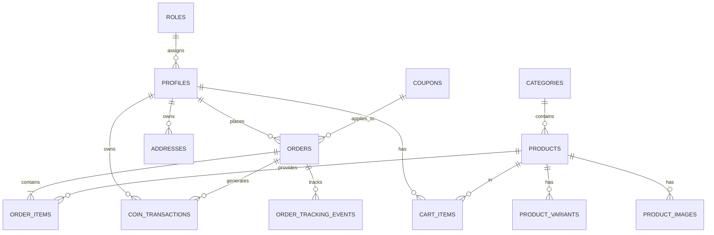

# Database Schema

## Cấu trúc bảng (Supabase)

| Tên bảng | Chức năng | Khóa ngoại (Foreign Keys) |
|---|---|---|
| `roles` | Lưu trữ định nghĩa quyền (admin, user) | N/A |
| `profiles` | Lưu thông tin người dùng mở rộng | `id` -> `auth.users(id)`, `role_id` -> `roles(id)` |
| `categories` | Phân loại sản phẩm | N/A |
| `products` | Lưu trữ thông tin cốt lõi của sản phẩm | `category_id` -> `categories(id)` |
| `product_variants` | Các biến thể (size, màu sắc) | `product_id` -> `products(id)` |
| `product_images` | Ảnh thư viện của sản phẩm | `product_id` -> `products(id)` |
| `promo_banners` | Quản lý banner quảng cáo | N/A |
| `cart_items` | Giỏ hàng tạm của user | `user_id`, `product_id`, `variant_id` |
| `orders` | Đơn hàng gốc của khách | `user_id`, `shipping_address_id`, `coupon_id` |
| `order_items` | Chi tiết từng mặt hàng trong đơn | `order_id`, `product_id`, `variant_id` |
| `addresses` | Sổ địa chỉ giao hàng của user | `user_id` -> `profiles(id)` |
| `coupons` | Mã giảm giá (hỗ trợ `min_order_amount` đơn tối thiểu) | N/A |
| `wishlists` | Sản phẩm lưu lại để xem sau | `user_id`, `product_id` |
| `reviews` | Đánh giá sản phẩm từ user | `user_id`, `product_id` |
| `order_tracking_events` | Các chặng/mốc hành trình vận chuyển thời gian thực (UNIQUE: `order_id, sequence_order`) | `order_id` -> `orders(id)` (ON DELETE CASCADE) |
| `coin_transactions` | Lịch sử biến động Xu (tích xu, tiêu xu, điểm danh, hoàn trả) | `user_id` -> `profiles(id)` (CASCADE), `order_id` -> `orders(id)` (SET NULL) |

### Cột mới bổ sung trong hệ thống Loyalty
- **`profiles`**: `coins_balance` (INT DEFAULT 0), `lifetime_coins` (INT DEFAULT 0), `membership_tier` (VARCHAR(20) DEFAULT 'bronze'), `last_checkin_date` (DATE).
- **`orders`**: `coins_used` (INT DEFAULT 0), `coins_discount` (NUMERIC(15,2) DEFAULT 0), `coins_earned` (INT DEFAULT 0).

## Row Level Security (RLS) Policies

Hệ thống tuân thủ bảo mật cấp dữ liệu cực kỳ chặt chẽ của Supabase:
- **Public (Bất kỳ ai):** Được phép XEM (SELECT) categories, products, promo_banners (chỉ khi `is_active = true`), product_images, reviews, và `order_tracking_events` (cho phép tra cứu vận đơn theo mã đơn hàng mà không bắt buộc đăng nhập). KHÔNG được phép INSERT/UPDATE/DELETE.
- **Authenticated User:** 
  - Chỉ được xem, thêm, sửa, xóa giỏ hàng (`cart_items`), địa chỉ (`addresses`), đơn hàng (`orders`), yêu thích (`wishlists`) **của chính mình** (Sử dụng điều kiện `auth.uid() = user_id`).
  - Được xem lịch sử xu của chính mình trong `coin_transactions` (`auth.uid() = user_id`).
- **Admin:** Được phép toàn quyền (ALL) thao tác trên toàn bộ dữ liệu (Điều kiện check `role_id` trỏ về 'admin' trong bảng `profiles`), bao gồm khởi tạo lộ trình và chuyển mốc vận chuyển (`order_tracking_events`).

## ERD (Entity Relationship Diagram)

## Database Triggers & Stored Procedures (Tự động hóa CSDL)

1. **`trg_deduct_stock_on_order_item` (`BEFORE INSERT ON order_items`)**:
   - Tự động kiểm tra số lượng tồn kho của biến thể hoặc sản phẩm cha với `FOR UPDATE` row-level lock.
   - Nếu số lượng mua vượt quá số lượng tồn kho: ném lỗi `RAISE EXCEPTION` và hủy transaction ngay lập tức.
   - Nếu hợp lệ: tự động trừ `stock_quantity` của `product_variants` và `products`.
2. **`trg_restore_stock_on_order_cancelled` (`AFTER UPDATE OF status ON orders`)**:
   - Khi trạng thái đơn hàng đổi thành `'cancelled'`, tự động hoàn trả số lượng các mặt hàng trong đơn vào `stock_quantity` của `product_variants` và `products`.
   - Nếu đơn hàng được mở lại từ `'cancelled'`, tự động trừ lại số lượng tương ứng.
3. **`get_public_order_tracking(p_search_code TEXT)` (RPC Stored Procedure)**:
   - Cho phép tra cứu công khai đơn hàng bằng cả mã ngắn 8 ký tự (`#BADE7DB9`), UUID đầy đủ, hoặc mã thanh toán (`payment_code`).
   - Khắc phục lỗi `invalid input syntax for type uuid` khi tìm kiếm bằng chuỗi ký tự ngắn.
   - Trả về cấu trúc JSON hợp nhất: thông tin đơn hàng, địa chỉ giao hàng, danh sách sản phẩm, và các mốc hành trình vận chuyển.
4. **`trg_profiles_membership_tier` (`BEFORE INSERT OR UPDATE OF lifetime_coins ON profiles`)**:
   - Tự động đồng bộ hóa `membership_tier` theo điểm trọn đời (`lifetime_coins`): Bronze (< 5.000 pts), Silver (5.000 - 19.999 pts), Gold (20.000 - 49.999 pts), Diamond (>= 50.000 pts).
5. **`trg_order_delivered_award_coins` (`BEFORE UPDATE OF status ON orders`)**:
   - Khi đơn hàng chuyển trạng thái sang `'delivered'`: tự động tính tỷ lệ hoàn xu dựa trên hạng thành viên của khách tại thời điểm giao hàng, cộng vào `coins_balance` & `lifetime_coins`, ghi nhận vào `coin_transactions` với type `'order_reward'`.
   - Khi đơn hàng bị hủy (`'cancelled'`) mà đã dùng xu: tự động hoàn trả toàn bộ số xu `coins_used` về tài khoản khách hàng với type `'order_refund'`.
6. **`claim_daily_checkin()` (RPC Stored Procedure)**:
   - SECURITY DEFINER function cho phép người dùng đăng nhập điểm danh 1 lần duy nhất trong ngày lịch (`last_checkin_date = CURRENT_DATE`).
   - Cộng xu thưởng theo hạng: Bronze (200), Silver (300), Gold (400), Diamond (500) và ghi nhận giao dịch vào `coin_transactions`.
